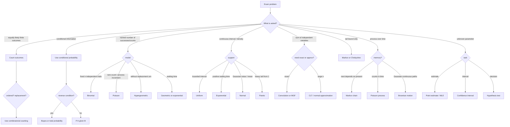

# Cheatsheet

Condensed exam sheet, rebuilt around [[stochastics-formulas]] and cross-checked against all ingested sources. Use the linked pages for assumptions, derivations, and examples.

## Probability basics and combinatorics

| Tool | Formula / rule | Full page |
|---|---|---|
| Discrete probability space | $\mathbb{P}(\Omega)=1$; for disjoint $A_i$, $\mathbb{P}(\bigcup_i A_i)=\sum_i\mathbb{P}(A_i)$ | [[discrete-probability-space]] |
| Laplace model | $\mathbb{P}(A)=|A|/|\Omega|$ | [[laplace-probability-space]] |
| Complement | $\mathbb{P}(A^c)=1-\mathbb{P}(A)$ | [[probability-rules]] |
| Monotonicity | $A\subseteq B\Rightarrow\mathbb{P}(A)\le\mathbb{P}(B)$ | [[probability-rules]] |
| Inclusion-exclusion | $\mathbb{P}(\bigcup_{i=1}^n A_i)=\sum_{k=1}^n(-1)^{k-1}\sum_{1\le i_1<\cdots<i_k\le n}\mathbb{P}(A_{i_1}\cap\cdots\cap A_{i_k})$ | [[inclusion-exclusion-principle]] |
| Product sample space | $\Omega=\prod_{i=1}^m\Omega_i$; sum point probabilities over event tuples | [[product-probability-space]] |
| Binomial coefficient | $\binom{M}{n}=M!/(n!(M-n)!)$; $\binom{m}{k}=\binom{m-1}{k-1}+\binom{m-1}{k}$ | [[combinatorial-counting]] |
| Binomial theorem | $(a+b)^m=\sum_{i=0}^m\binom{m}{i}a^i b^{m-i}$ | [[combinatorial-counting]] |
| Ordered with replacement | $M^n$ | [[combinatorial-counting]] |
| Ordered without replacement | $M!/(M-n)!$ | [[combinatorial-counting]] |
| Unordered without replacement | $\binom{M}{n}$ | [[combinatorial-counting]] |
| Unordered with replacement | $\binom{M+n-1}{n}$ | [[combinatorial-counting]] |

## Conditional probability and independence

| Tool | Formula / rule | Full page |
|---|---|---|
| Conditional probability | $\mathbb{P}(A\mid B)=\mathbb{P}(A\cap B)/\mathbb{P}(B)$, $\mathbb{P}(B)>0$ | [[conditional-probability]] |
| Conditional complement | $\mathbb{P}(A\mid B)+\mathbb{P}(A^c\mid B)=1$ | [[conditional-probability]] |
| Total probability | $\mathbb{P}(A)=\sum_{i\in I}\mathbb{P}(A\mid B_i)\mathbb{P}(B_i)$ for a partition $(B_i)$ | [[law-of-total-probability]] |
| Bayes formula | $\mathbb{P}(B_i\mid A)=\dfrac{\mathbb{P}(B_i)\mathbb{P}(A\mid B_i)}{\sum_j\mathbb{P}(B_j)\mathbb{P}(A\mid B_j)}$ | [[bayes-formula]] |
| Event independence | $A,B$ independent iff $\mathbb{P}(A\cap B)=\mathbb{P}(A)\mathbb{P}(B)$ | [[independence]] |
| Finite-family independence | $\mathbb{P}(\bigcap_{i\in J}A_i)=\prod_{i\in J}\mathbb{P}(A_i)$ for every finite $J$ | [[independence]] |
| Random-variable independence | $\mathbb{P}(X_1\in A_1,\ldots,X_n\in A_n)=\prod_i\mathbb{P}(X_i\in A_i)$ | [[independence]] |

## Random variables, CDFs, densities, expectation

| Topic | Formula | Full page |
|---|---|---|
| Distribution of $X$ | $\mathbb{P}_X(A)=\mathbb{P}(\{\omega:X(\omega)\in A\})$ | [[random-variable]] |
| CDF | $F_X(y)=\mathbb{P}(X\le y)$ | [[cumulative-distribution-function]] |
| Point mass from CDF | $\mathbb{P}(X=y)=F_X(y)-F_X(y^-)$ | [[cumulative-distribution-function]] |
| Closed interval | $\mathbb{P}(a\le X\le b)=F_X(b)-F_X(a^-)$ | [[cumulative-distribution-function]] |
| Density conditions | $f(x)\ge0$, $\int_{-\infty}^{\infty}f(x)\,dx=1$ | [[probability-density]] |
| Density to CDF | $F_X(y)=\int_{-\infty}^{y}f(x)\,dx$ | [[probability-density]] |
| Discrete expectation | $\mathbb{E}[X]=\sum_y y\,\mathbb{P}(X=y)$ | [[expectation]] |
| Continuous expectation | $\mathbb{E}[X]=\int_{-\infty}^{\infty}x f_X(x)\,dx$ | [[expectation]] |
| Function of a variable | $\mathbb{E}[h(X)]=\sum_x h(x)\mathbb{P}(X=x)$ or $\int h(x)f_X(x)\,dx$ | [[expectation]] |
| Linearity | $\mathbb{E}[X+Y]=\mathbb{E}[X]+\mathbb{E}[Y]$, $\mathbb{E}[aX]=a\mathbb{E}[X]$ | [[expectation]] |
| Indicator | $\mathbb{E}[\mathbf{1}_A]=\mathbb{P}(A)$ | [[expectation]] |
| Conditional expectation on event | $\mathbb{E}[X\mid A]=\mathbb{E}[X\mathbf{1}_A]/\mathbb{P}(A)$ | [[conditional-expectation]] |
| Total expectation | $\mathbb{E}[X]=\sum_i\mathbb{P}(B_i)\mathbb{E}[X\mid B_i]$ | [[conditional-expectation]] |

## Named distributions

| Distribution | Support / law | $\mathbb{E}[X]$ | $\mathrm{Var}(X)$ | Full page |
|---|---|---:|---:|---|
| Dirac at $\omega_0$ | $\mathbb{P}(\omega_0)=1$ | value | $0$ | [[dirac-distribution]] |
| Bernoulli$(p)$ | $\mathbb{P}(X=1)=p$, $\mathbb{P}(X=0)=1-p$ | $p$ | $p(1-p)$ | [[bernoulli-distribution]] |
| Binomial$(n,p)$ | $\mathbb{P}(X=k)=\binom{n}{k}p^k(1-p)^{n-k}$ | $np$ | $np(1-p)$ | [[binomial-distribution]] |
| Poisson$(\lambda)$ | $\mathbb{P}(X=k)=e^{-\lambda}\lambda^k/k!$ | $\lambda$ | $\lambda$ | [[poisson-distribution]] |
| Geometric, TUHH convention | $\mathbb{P}(X=k)=p^k(1-p)$, $k\in\mathbb{N}_0$ | $p/(1-p)$ | $p/(1-p)^2$ | [[geometric-distribution]] |
| Hypergeometric | $\mathbb{P}(X=k)=\dfrac{\binom{b}{k}\binom{r}{n-k}}{\binom{b+r}{n}}$ | $n b/(b+r)$ | see page | [[hypergeometric-distribution]] |
| Discrete uniform | $\mathbb{P}(X=k)=1/n$, $k=1,\ldots,n$ | $(n+1)/2$ | $(n^2-1)/12$ | [[discrete-uniform-distribution]] |
| Uniform$([a,b])$ | $f(x)=1/(b-a)$ on $[a,b]$ | $(a+b)/2$ | $(b-a)^2/12$ | [[uniform-distribution]] |
| Pareto$(\alpha)$ | $F(y)=0$ for $y<1$, $1-y^{-\alpha}$ for $y\ge1$ | finite iff $\alpha>1$ | finite iff $\alpha>2$ | [[pareto-distribution]] |
| Exponential$(\lambda)$ | $F(y)=1-e^{-\lambda y}$ for $y\ge0$ | $1/\lambda$ | $1/\lambda^2$ | [[exponential-distribution]] |
| Standard normal | $\varphi(x)=\frac1{\sqrt{2\pi}}e^{-x^2/2}$ | $0$ | $1$ | [[normal-distribution]] |
| Normal$(\mu,\sigma^2)$ | $(X-\mu)/\sigma\sim\mathcal{N}(0,1)$ | $\mu$ | $\sigma^2$ | [[normal-distribution]] |
| Erlang$(\lambda,n)$ | $f(x)=\frac{\lambda^n x^{n-1}}{(n-1)!}e^{-\lambda x}$ | $n/\lambda$ | $n/\lambda^2$ | [[erlang-distribution]] |

> ?? Formula-sheet error: [[stochastics-formulas]] p.1 writes the geometric PMF $p^k(1-p)$ but gives moments from another convention. Use the corrected row above; see [[geometric-distribution]].

## Variance, covariance, sums, and generating functions

| Topic | Formula | Full page |
|---|---|---|
| Computational variance | $\mathrm{Var}(X)=\mathbb{E}[X^2]-\mathbb{E}[X]^2$ | [[variance-covariance-correlation]] |
| Scaling/shift | $\mathrm{Var}(aX)=a^2\mathrm{Var}(X)$, $\mathrm{Var}(X+c)=\mathrm{Var}(X)$ | [[variance-covariance-correlation]] |
| Covariance | $\mathrm{Cov}(X,Y)=\mathbb{E}[XY]-\mathbb{E}[X]\mathbb{E}[Y]$ | [[variance-covariance-correlation]] |
| Correlation | $\rho_{X,Y}=\mathrm{Cov}(X,Y)/(\sqrt{\mathrm{Var}(X)}\sqrt{\mathrm{Var}(Y)})$ | [[variance-covariance-correlation]] |
| Variance of sum | $\mathrm{Var}(\sum_iX_i)=\sum_i\mathrm{Var}(X_i)+2\sum_{i<j}\mathrm{Cov}(X_i,X_j)$ | [[variance-covariance-correlation]] |
| Independent products | If $X,Y$ independent, $\mathbb{E}[XY]=\mathbb{E}[X]\mathbb{E}[Y]$ | [[independence]] |
| Discrete convolution | $\mathbb{P}(X+Y=m)=\sum_h\mathbb{P}(X=m-h)\mathbb{P}(Y=h)$ | [[convolution-of-distributions]] |
| Density convolution | $f_{X+Y}(t)=\int_{-\infty}^{\infty}f_X(t-s)f_Y(s)\,ds$ | [[convolution-of-distributions]] |
| MGF | $M_X(t)=\mathbb{E}[e^{tX}]$ | [[moment-generating-function]] |
| Moments from MGF | $\mathbb{E}[X^m]=M_X^{(m)}(0)$ | [[moment-generating-function]] |
| Independent MGF product | $M_{X+Y}(t)=M_X(t)M_Y(t)$ | [[moment-generating-function]] |
| Equal distribution | $X,Y$ have same law iff $M_X(t)=M_Y(t)$ where the MGF determines the law | [[moment-generating-function]] |
| Wald identity | $\mathbb{E}[\sum_{k=1}^{N}X_k]=\mathbb{E}[N]\mathbb{E}[X_1]$ under the stated independence assumptions | [[wald-identity]] |

## Inequalities, convergence, and normal approximations

| Result | Formula | Full page |
|---|---|---|
| Markov inequality | $\mathbb{P}(|X|\ge u)\le\mathbb{E}[h(|X|)]/h(u)$ for monotone $h$ | [[markov-inequality]] |
| Chebyshev inequality | $\mathbb{P}(|X-\mathbb{E}[X]|\ge u)\le\mathrm{Var}(X)/u^2$ | [[chebyshev-inequality]] |
| Weak law | If $(X_i)$ i.i.d. and $\mathbb{E}[X_1^2]<\infty$, then $S_n/n\xrightarrow{P}\mathbb{E}[X_1]$ | [[weak-law-large-numbers]] |
| Convergence in probability | $X_n\xrightarrow{P}X$ iff $\mathbb{P}(|X_n-X|\ge\varepsilon)\to0$ for every $\varepsilon>0$ | [[convergence-of-random-variables]] |
| Convergence in distribution | $X_n\xrightarrow{d}X$ iff $F_{X_n}(t)\to F_X(t)$ at continuity points of $F_X$ | [[convergence-of-random-variables]] |
| CLT | $\dfrac{S_n-n\mathbb{E}[X_1]}{\sqrt{n}\sqrt{\mathrm{Var}(X_1)}}\xrightarrow{d}\mathcal{N}(0,1)$ | [[central-limit-theorem]] |
| De Moivre-Laplace | For $Y_n\sim\mathrm{Bin}(n,p)$, $\mathbb{P}(Y_n\le u)\approx\Phi\left((u-np)/\sqrt{np(1-p)}\right)$ | [[de-moivre-laplace-theorem]] |
| Standardization | If $X\sim\mathcal{N}(\mu,\sigma^2)$, then $(X-\mu)/\sigma\sim\mathcal{N}(0,1)$ | [[normal-distribution]] |

## Stochastic processes

| Topic | Formula / fact | Full page |
|---|---|---|
| Process | $(X_t)_{t\in T}$ is a family of random variables; paths are $t\mapsto X_t(\omega)$ | [[stochastic-process]] |
| Mean/covariance functions | $\mu(t)=\mathbb{E}[X_t]$, $\rho(s,t)=\mathrm{Cov}(X_s,X_t)$ | [[stochastic-process]] |
| Markov property | $\mathbb{P}(X_{t+1}=j\mid X_t=i)=p_{ij}$; finite update $p(t+1)=p(t)P$ | [[markov-chain]] |
| Poisson process increments | $N_t-N_s\sim\mathrm{Poisson}(\lambda(t-s))$ for $s\le t$ | [[poisson-process]] |
| Poisson conditional count | $\mathbb{P}(N_s=k\mid N_t=n)=\binom{n}{k}(s/t)^k(1-s/t)^{n-k}$ | [[poisson-process]] |
| Brownian motion | $B_0=0$, continuous paths, independent increments, $B_t-B_s\sim\mathcal{N}(0,t-s)$ | [[brownian-motion]] |
| Brownian marginal | $B_t\sim\mathcal{N}(0,t)$ | [[brownian-motion]] |
| Independent increments | $X_{t_1}-X_{t_0},\ldots,X_{t_n}-X_{t_{n-1}}$ are independent | [[stochastic-process]] |

## Statistics

| Topic | Formula | Full page |
|---|---|---|
| Statistical model | $(X,\mathcal{F}_X,(\mathbb{P}_\theta)_{\theta\in\Theta})$ | [[point-estimation]] |
| Sample mean | $\bar{X}_n=\frac1n\sum_{i=1}^nX_i$ | [[point-estimation]] |
| Sample variance | $S_X^2=\frac1{n-1}\sum_{i=1}^n(X_i-\bar{X}_n)^2$ | [[point-estimation]] |
| Sample median | sorted $x_{(i)}$: middle value if $n$ odd, average of the two middle values if $n$ even | [[point-estimation]] |
| Unbiased estimator | $\mathbb{E}_\theta[T]=\gamma(\theta)$ | [[point-estimation]] |
| Bias | $B_T(\theta)=\mathbb{E}_\theta[T]-\gamma(\theta)$ | [[point-estimation]] |
| Consistency | $\mathbb{P}_\theta(|T_n-\gamma(\theta)|\ge\varepsilon)\to0$ | [[point-estimation]] |
| Likelihood | $L_x(\theta)=\mathbb{P}_\theta(\{x\})$ or product of i.i.d. masses/densities | [[maximum-likelihood-estimation]] |
| MLE | choose $T(x)\in\arg\max_{\theta\in\Theta}L_x(\theta)$ | [[maximum-likelihood-estimation]] |
| Confidence interval | $\mathbb{P}_\theta(\tau(\theta)\in C(X))\ge1-\alpha$ | [[confidence-intervals]] |
| Gaussian CI, known $\sigma_0$ | $\bar{X}_n\pm z_{1-\alpha/2}\sigma_0/\sqrt n$ | [[confidence-intervals]] |
| One-sided Gaussian CI | $(\bar{X}_n-z_{1-\alpha}\sigma_0/\sqrt n,\infty)$ | [[confidence-intervals]] |
| Quantile | $q_p$: $\mathbb{P}(X\le q_p)\ge p$ and $\mathbb{P}(X\ge q_p)\ge1-p$ | [[quantile]] |
| Test | $H_0:\theta\in\Theta_0$, $H_1:\theta\in\Theta_1$, $\varphi:X\to\{0,1\}$ | [[hypothesis-testing]] |
| Level | $\mathbb{P}_\theta(\varphi(X)=1)\le\alpha$ for all $\theta\in\Theta_0$ | [[hypothesis-testing]] |
| Power | $\mathbb{P}_\theta(\varphi(X)=1)$ for $\theta\in\Theta_1$ | [[hypothesis-testing]] |
| One-sided Gaussian test | reject $H_0:\mu\le\mu_0$ if $\bar{X}_n\ge\mu_0+z_{1-\alpha}\sigma_0/\sqrt n$ | [[hypothesis-testing]] |
| Two-sided Gaussian test | reject $H_0:\mu=\mu_0$ outside $\mu_0\pm z_{1-\alpha/2}\sigma_0/\sqrt n$ | [[hypothesis-testing]] |
| One-sided binomial test | for $H_0:p\le p_0$ vs $H_1:p>p_0$, reject for sufficiently large $\sum_iX_i$ | [[hypothesis-testing]] |

## Which distribution / which tool do I reach for?

## Last-minute convention checks

- Use $\mathbb{P}$, $\mathbb{E}[X]$, and $\mathrm{Var}(X)$ consistently.
- Geometric page convention: $\mathbb{P}(X=k)=p^k(1-p)$ means $p$ is continuation probability, not success probability.
- For normal formulas here, $\sigma_0$ is known; unknown-variance $t$-intervals were not present in the ingested sources.
- For CDF interval probabilities, check endpoint openness with $F(a)$ versus $F(a^-)$.
- For tests, $\varphi(x)=1$ means reject $H_0$; $\varphi(x)=0$ means do not reject.
