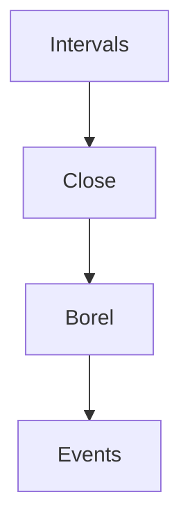

# Borel Sigma Algebra
> The Borel sigma-algebra collects the real-line events generated by intervals, so real-valued [[random-variable|random variables]] can be measured consistently.

## Formal definition
On $\mathbb{R}$, the Borel sigma-algebra is
$$
\mathcal{B}(\mathbb{R})=\sigma\bigl(\{(a,b):a,b\in\mathbb{R},\ a<b\}\bigr).
$$
Here $\sigma(\cdot)$ denotes the smallest [[sigma-algebra]] containing the listed generator sets. For $\Omega\subseteq\mathbb{R}^d$, the notes generate Borel sets from boxes.

## Intuition

## Relation to other ideas
- A [[probability-space]] uses a sigma-algebra $\mathcal{F}$ of allowed events; in real-valued models this is commonly $\mathcal{B}(\mathbb{R})$.
- A [[random-variable]] $X:\Omega	o\mathbb{R}$ is measurable when $X^{-1}(B)\in\mathcal{F}$ for every $B\in\mathcal{B}(\mathbb{R})$.
- [[lebesgue-measure]] is the length/volume reference measure defined on Borel sets in the lecture notes.

## Pitfalls
- Not every subset of $\mathbb{R}$ is treated as an event in the measured-space setup; the course works with Borel sets for continuous distributions.

## Appears in
- [[stochastics-4-5]] p.10-p.12
- [[stochastics-6-7]] p.1

