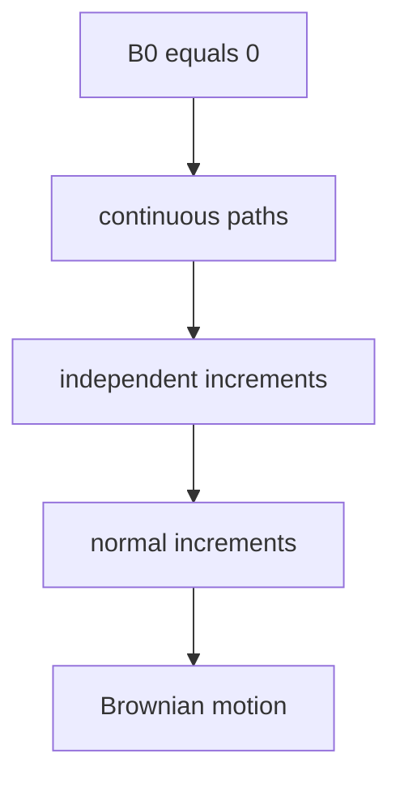

# Brownian Motion
> Brownian motion is a continuous-path stochastic process with independent Gaussian increments.

## Formal definition from the source

A stochastic process $(B_t)_{t\ge0}$ is Brownian motion if:

1. $\mathbb{P}(B_0=0)=1$.
2. $\mathbb{P}(t\mapsto B_t\text{ is continuous on }[0,\infty))=1$.
3. $(B_t)_{t\ge0}$ has independent increments.
4. For $0\le s<t$,
   $$
   B_t-B_s\sim\mathcal{N}(0,t-s).
   $$
   The source writes this as a normal law with standard deviation $\sqrt{t-s}$.

## Scaling property from the exercise

For $c>0$, the source verifies that
$$
\left(\frac{1}{\sqrt{c}}B_{ct}\right)_{t\ge0}
$$
is again Brownian motion. The proof checks the four defining properties: start at zero, unchanged continuity under scaling, independent increments, and
$$
\frac{1}{\sqrt{c}}(B_{ct}-B_{cs})\sim\mathcal{N}(0,t-s).
$$

## Relation to other ideas

- Brownian motion is a [[stochastic-process]] with continuous paths.
- Its increments use the [[normal-distribution]].
- Like the [[poisson-process]], it has independent increments, but Brownian motion is continuous while the Poisson process jumps.

## Pitfalls

- In the wiki notation table, $\mathcal{N}(0,t-s)$ means variance $t-s$. The handwritten source often writes a normal law by mean and standard deviation.
- Independent increments do not mean the values $B_s$ and $B_t$ themselves are independent.

## Appears in

[[stochastics-1]], [[normal-distribution]], [[stochastic-processes-and-statistics-exercises]]

