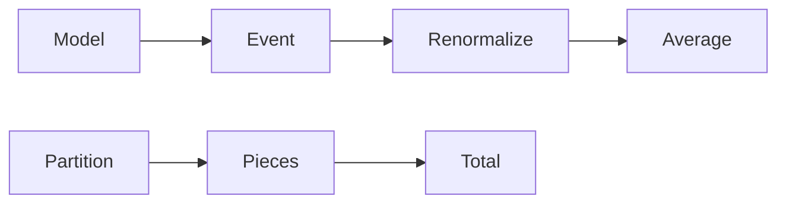

# Conditional Expectation (*bedingter Erwartungswert*)
> Conditional expectation is the [[expectation]] computed after replacing the original probability measure by a [[conditional-probability|conditional probability]] measure.

## Formal definition

Let $(\Omega,\mathcal{F},\mathbb{P})$ be a [[probability-space]] and let $A\in\mathcal{F}$ satisfy $\mathbb{P}(A)>0$. The source first notes that
$$
\mathbb{P}(\,\cdot\mid A):\mathcal{F}\to[0,1],\qquad B\mapsto\mathbb{P}(B\mid A)
$$
is itself a probability measure. For an integrable [[random-variable]] $X$,
$$
\mathbb{E}[X\mid A]
=\frac{\mathbb{E}[X\mathbf{1}_A]}{\mathbb{P}(A)}.
$$
Here $\mathbf{1}_A$ is the indicator of $A$.

For a countable or finite partition $(B_i)_{i\in I}$ of $\Omega$ with $\mathbb{P}(B_i)>0$ and $\mathbb{E}[|X|]<\infty$, the source gives
$$
\mathbb{E}[X]=\sum_{i\in I}\mathbb{P}(B_i)\mathbb{E}[X\mid B_i].
$$

## Intuition

Conditioning on $A$ restricts attention to outcomes in $A$ and renormalizes probabilities.



## Worked examples from the source

With $\Omega=\{1,\ldots,6\}$, $X(\omega)=\omega$, and $A=\{2,4,6\}$,
$$
\mathbb{P}(\{\omega\}\mid A)=\begin{cases}
1/3,&\omega\in\{2,4,6\},\\
0,&\omega\in\{1,3,5\},
\end{cases}
$$
so
$$
\mathbb{E}[X\mid A]=2\cdot\frac13+4\cdot\frac13+6\cdot\frac13=4.
$$

Exercise 8 conditions on $A=$ "the die labelled by ones and twos shows $1$". If $X$ is the ordinary die and $Y$ the labelled die, then the source concludes
$$
\mathbb{E}[X+Y\mid A]=4.5.
$$

## Procedure

```text
1. Identify the conditioning event A and verify \mathbb{P}(A) > 0.
2. Replace every probability \mathbb{P}(B) by \mathbb{P}(B | A) = \mathbb{P}(B ∩ A) / \mathbb{P}(A).
3. For a discrete variable, list the conditional probabilities \mathbb{P}(X = x | A).
4. Sum x · \mathbb{P}(X = x | A), or use \mathbb{E}[X 1_A] / \mathbb{P}(A).
5. For a partition, compute each \mathbb{E}[X | B_i] and weight it by \mathbb{P}(B_i).
```

## Relation to other ideas

- [[wald-identity]] is proved in the source by conditioning on the random count $N$.
- [[law-of-total-probability]] is the analogous probability formula; this page records the expectation version.
- [[conditional-probability]] provides the renormalized probability measure used here.

## Pitfalls

- $\mathbb{P}(A)>0$ is mandatory.
- Do not average only the numerically possible values; average them with their conditional probabilities.

## Appears in

[[stochastics]], [[lecture-block-8-9-exercises]], [[expectation]], [[conditional-probability]]

