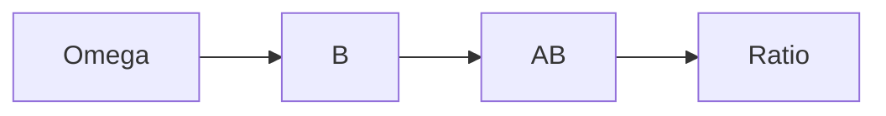

# Conditional Probability (*bedingte Wahrscheinlichkeit*)
> Conditional probability is the probability of $A$ after the event $B$ is known to have occurred.

## Formal definition

Let $(\Omega,\mathbb{P})$ be a [[discrete-probability-space]] and let $A,B\subseteq\Omega$ with $\mathbb{P}(B)>0$. The conditional probability of $A$ given $B$ is
$$
\mathbb{P}(A\mid B)=\frac{\mathbb{P}(A\cap B)}{\mathbb{P}(B)}.
$$

The source notes emphasize the interpretation "we know $B$ occurs." For fixed $B$ with positive probability, the map
$$
A\mapsto \mathbb{P}(A\mid B)
$$
is again a probability distribution on $\Omega$.

## Intuition

## Worked examples from the source

### Fair die

For $\Omega=\{1,\ldots,6\}$, $E=\{2,4,6\}$, and $S=\{1,2,3\}$,
$$
\mathbb{P}(E\mid S)=\frac{\mathbb{P}(E\cap S)}{\mathbb{P}(S)}
=\frac{1/6}{3/6}=\frac13.
$$

### Two children

Let $0$ mean female and $1$ mean male, so $\Omega=\{0,1\}^2$ with equal probabilities.

- If $A$ is "at least one child is a girl" and $B$ is "the other child is also a girl," then $A=\{(0,1),(0,0),(1,0)\}$, $B=\{(0,0)\}$, and
  $$\mathbb{P}(B\mid A)=\frac{1/4}{3/4}=\frac13.$$
- If $A$ is "the older child is a girl," then $A=\{(0,1),(0,0)\}$, and
  $$\mathbb{P}(B\mid A)=\frac{1/4}{2/4}=\frac12.$$

## Relation to other ideas

- [[law-of-total-probability]] decomposes $\mathbb{P}(A)$ using conditional probabilities over a partition.
- [[bayes-formula]] reverses the conditioning direction.
- [[independence]] is equivalent to $\mathbb{P}(A\mid B)=\mathbb{P}(A)$ when $\mathbb{P}(B)>0$.

## Pitfalls

- The condition must have positive probability.
- "At least one child is a girl" and "the older child is a girl" are different information events, so they produce different conditional probabilities.

## Appears in

[[stochastics-4-5]], [[lecture-block-4-5-exercises]], [[diagnostic-testing-bayes]]

