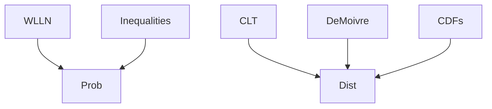

# Convergence of Random Variables
> The source uses convergence in probability and convergence in distribution to describe limiting behavior of sequences of [[random-variable|random variables]].

## Formal definition

A sequence $(X_n)_{n\in\mathbb{N}}$ converges in probability to $X$ if, for every $\varepsilon>0$,
$$
\lim_{n\to\infty}\mathbb{P}(|X_n-X|\ge\varepsilon)=0.
$$
Notation: $X_n\xrightarrow{P}X$.

A sequence $(X_n)_{n\in\mathbb{N}}$ converges in distribution to $X$ if
$$
\lim_{n\to\infty}F_{X_n}(t)=F_X(t)
$$
for every $t\in\mathbb{R}$ at which $F_X$ is continuous. Notation: $X_n\xrightarrow{d}X$.

The source also states that a collection of random variables is independent if every finite subcollection is independent, and uses "i.i.d." for independent and identically distributed.

## Relationship between notions used here



## Procedures

### Proving convergence in probability from a bound

```text
1. Fix an arbitrary epsilon > 0.
2. Express \mathbb{P}(|X_n - X| >= epsilon).
3. Bound it with Markov's or Chebyshev's inequality if possible.
4. Take n -> infinity in the bound.
5. Conclude convergence in probability if the bound tends to 0.
```

### Proving convergence in distribution via CDFs

```text
1. Compute the CDF F_n(t) of X_n.
2. Compute or identify the candidate limit CDF F(t).
3. For each continuity point t of F, take lim_{n->infinity} F_n(t).
4. Conclude X_n -> X in distribution if the pointwise limit equals F(t).
```

## Examples from the source

- If $X_n\sim\mathrm{Exp}(n)$, then $X_n\xrightarrow{P}0$, because for $\varepsilon>0$,
  $$
  \mathbb{P}(|X_n-0|>\varepsilon)=\mathbb{P}(X_n>\varepsilon)=e^{-n\varepsilon}\to0.
  $$
- If $Y_1,Y_2,\ldots$ are independent [[bernoulli-distribution|Bernoulli]]$(p)$ variables with $0<p<1$ and $X_n=\prod_{i=1}^nY_i$, then $X_n\xrightarrow{P}0$, because $p^n\to0$.
- If $X_n$ is uniform on the grid $\{1/n,2/n,\ldots,n/n\}$, then
  $$
  F_n(t)=\begin{cases}
  0,&t\le0,\\
  \lfloor nt\rfloor/n,&t\in(0,1),\\
  1,&t\ge1,
  \end{cases}
  $$
  and $X_n\xrightarrow{d}U(0,1)$.

## Consistency of estimators

stochastics-1.pdf uses convergence in probability to define consistent [[point-estimation|estimator]] sequences. An estimator sequence $(T_n)$ is consistent for $\gamma(\theta)$ if
$$
T_n\xrightarrow{P}\gamma(\theta)
$$
for every allowed parameter value $\theta$. The p.21 exercise shows that a biased estimator can still be consistent.

## Pitfalls

- Distribution convergence is checked only at continuity points of the limit CDF.
- Convergence in probability controls deviations from a random variable, not just CDF values.

## Appears in

[[stochastics]], [[weak-law-large-numbers]], [[central-limit-theorem]], [[de-moivre-laplace-theorem]], [[lecture-block-8-9-exercises]]

