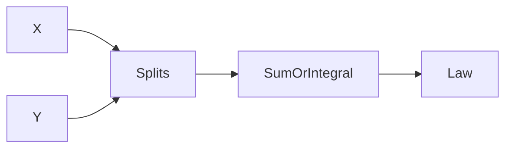

# Convolution of Distributions (*Faltung*)
> Convolution gives the law of a sum of independent [[random-variable|random variables]] from the component laws.

## Formal definition

For independent integer-valued $X$ and $Y$,
$$
\mathbb{P}(X+Y=m)=\sum_{k=-\infty}^{\infty}\mathbb{P}(X=m-k)\mathbb{P}(Y=k),\qquad m\in\mathbb{Z}.
$$

For densities $f,g:\mathbb{R}\to\mathbb{R}$, their convolution is
$$
(f*g)(t)=\int_{-\infty}^{\infty}f(t-s)g(s)\,ds.
$$
If independent $X$ and $Y$ have densities $f_X$ and $f_Y$, then $X+Y$ has density $f_{X+Y}=f_X*f_Y$.

## Intuition

To get a total $t$, split it into one part $t-s$ produced by $X$ and one part $s$ produced by $Y$, then sum or integrate over all splits.



## Procedure

```text
1. Verify X and Y are independent.
2. Decide whether the variables are integer-valued or density-valued.
3. For integer-valued variables, sum \mathbb{P}(X = m-k) \mathbb{P}(Y = k) over all k.
4. For densities, integrate f_X(t-s) f_Y(s) over all real s.
5. Use the supports to reduce the sum or integral to nonzero terms.
6. Match the resulting mass function or density to a named distribution if possible.
```

## Examples from the source

For independent $X\sim\mathrm{Poi}(\lambda)$ and $Y\sim\mathrm{Poi}(\mu)$,
$$
X+Y\sim\mathrm{Poi}(\lambda+\mu).
$$

For independent $N_1,N_2\sim\mathcal{N}(0,1)$, convolution gives
$$
N_1+N_2\sim\mathcal{N}(0,2).
$$

For independent $X,Y\sim U(0,1)$,
$$
f_{X+Y}(t)=\begin{cases}
t,&0\le t\le1,\\
2-t,&1<t\le2,\\
0,&\text{otherwise}.
\end{cases}
$$

If $X\sim\mathrm{Erl}(\lambda,n)$ and $Y\sim\mathrm{Exp}(\lambda)$ are independent, then $X+Y\sim\mathrm{Erl}(\lambda,n+1)$.

## Relation to other ideas

- [[moment-generating-function|MGFs]] provide an alternative method for sums, because independent sums multiply MGFs.
- [[independence]] is essential; without it the product formulas need not hold.

## Appears in

[[stochastics]], [[lecture-block-8-9-exercises]], [[poisson-distribution]], [[normal-distribution]], [[uniform-distribution]], [[erlang-distribution]]

