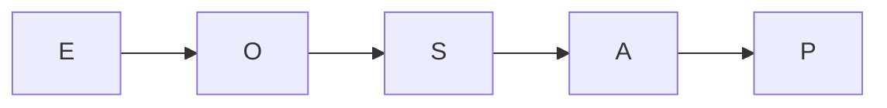

# Discrete Probability Space (*diskreter Wahrscheinlichkeitsraum*)
> A discrete probability space assigns probabilities to events in an at most countable set of possible outcomes.

## Formal definition

A random experiment has an unpredictable but repeatable outcome. Its sample space is the set $
\Omega$ of all possible outcomes. An elementary event is a single outcome $\omega\in\Omega$, and an event is a subset $A\subseteq\Omega$.

A discrete probability space is a pair $(\Omega,\mathbb{P})$ where:

- $\Omega\neq\varnothing$ is at most countable;
- $\mathbb{P}:\mathcal{P}(\Omega)\to[0,1]$ maps each event to a probability;
- $\mathbb{P}(\Omega)=1$;
- for pairwise disjoint events $A_1,A_2,\ldots\subseteq\Omega$,
  $$
  \mathbb{P}\left(\bigcup_{k=1}^{\infty}A_k\right)=\sum_{k=1}^{\infty}\mathbb{P}(A_k).
  $$

Here $\mathcal{P}(\Omega)=\{A:A\subseteq\Omega\}$ is the power set of $\Omega$.

For finite $\Omega$, countable additivity is equivalent to finite additivity:
$$
A\cap B=\varnothing\quad\Rightarrow\quad \mathbb{P}(A\cup B)=\mathbb{P}(A)+\mathbb{P}(B).
$$

## Intuition

The notes use dice and coin tossing as guiding examples: a die roll has $\Omega=\{1,2,3,4,5,6\}$, an elementary event could be $\{6\}$, and an event could be $\{2,4,6\}$.

## Relation to other ideas

- [[laplace-probability-space]] is the special finite case where every elementary outcome has the same probability.
- [[probability-distribution]] builds probabilities from point masses $p_\omega=\mathbb{P}(\{\omega\})$.
- [[product-probability-space]] combines several discrete probability spaces for repeated experiments.
- [[probability-rules]] lists useful consequences of the axioms.

## Pitfalls

- Events are sets; elementary events are elements of $\Omega$ or singleton sets $\{\omega\}$ depending on context.
- Additivity requires disjointness. If events overlap, use [[inclusion-exclusion-principle]].

## Appears in

[[stochastics-1-2]], [[lecture-block-1-2-exercises]]

