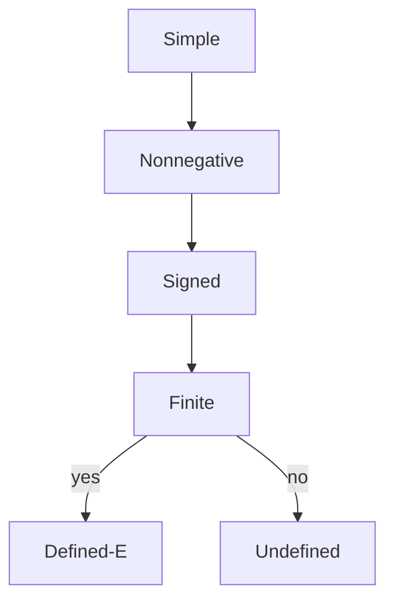

# Expectation (*Erwartungswert*)
> Expectation is the probability-weighted average of a [[random-variable]], computed by a sum in discrete cases and by an integral for densities.

## Formal definition

For a discrete probability space $(\Omega,\mathbb{P})$ and a random variable $X$ with absolutely convergent sum,
$$
\mathbb{E}[X]=\sum_{\omega\in\Omega}X(\omega)\mathbb{P}(\{\omega\}).
$$
Equivalently, if $X(\Omega)$ is at most countable,
$$
\mathbb{E}[X]=\sum_{y\in X(\Omega)} y\,\mathbb{P}(X=y).
$$
For a density $f$,
$$
\mathbb{E}[X]=\int_{-\infty}^{\infty}x f(x)\,dx,
$$
provided at least one of the positive/negative parts is finite. If $\int |x|f(x)\,dx<\infty$, then $X$ is integrable and the expectation is finite.

For a measurable function $h$ and $Y=h(X)$:
$$
\mathbb{E}[Y]=\sum_{x\in X(\Omega)}h(x)\mathbb{P}(X=x)
$$
for discrete $X$, and
$$
\mathbb{E}[Y]=\int_{-\infty}^{\infty}h(x)f(x)\,dx
$$
for a density $f$.

## Properties from the lecture

If $\mathbb{E}[|X|]<\infty$ and $\mathbb{E}[|Y|]<\infty$, then:

- Linearity: $\mathbb{E}[X+Y]=\mathbb{E}[X]+\mathbb{E}[Y]$.
- Scaling: $\mathbb{E}[aX]=a\mathbb{E}[X]$.
- Constant: if $X=c$, then $\mathbb{E}[X]=c$.
- Positivity: if $X\ge0$, then $\mathbb{E}[X]\ge0$.
- Monotonicity: if $X\ge Y$, then $\mathbb{E}[X]\ge\mathbb{E}[Y]$.
- If $X,Y$ are independent and integrable, then $\mathbb{E}[XY]=\mathbb{E}[X]\mathbb{E}[Y]$.

The notes construct the general expectation by first defining simple random variables, then nonnegative variables by increasing simple approximations, and finally signed variables by $X=X_+-X_-$.



## Procedure: compute an expectation

```text
1. Identify whether X is discrete or has a density.
2. For a discrete X, list all possible values y and probabilities \mathbb{P}(X=y).
3. For a density, write the integral over the intervals where the density is nonzero.
4. Multiply each value x by its probability mass or density f(x).
5. Sum or integrate.
6. Check finiteness or absolute integrability when the support is infinite.
```

## Key examples from the source

| Distribution / variable | Result |
|---|---|
| Indicator $\mathbf{1}_A$ | $\mathbb{E}[\mathbf{1}_A]=\mathbb{P}(A)$ |
| [[poisson-distribution]]$(\lambda)$ | $\mathbb{E}[X]=\lambda$ |
| [[binomial-distribution]]$(n,p)$ | $\mathbb{E}[X]=np$ |
| [[uniform-distribution]]$([a,b])$ | $\mathbb{E}[X]=(a+b)/2$ |
| [[exponential-distribution]]$(\lambda)$ | $\mathbb{E}[X]=1/\lambda$ |
| Standard [[normal-distribution]] | $\mathbb{E}[X]=0$ |
| [[discrete-uniform-distribution]] on $\{1,\ldots,n\}$ | $\mathbb{E}[X]=(n+1)/2$ |
| Maximum of $n$ independent uniforms on $[0,1]$ | $\mathbb{E}[\max_i U_i]=n/(n+1)$ |

## Conditional and random-sum extensions from stochastics.pdf

The later source adds [[conditional-expectation]] for an event $A$ with $\mathbb{P}(A)>0$:
$$
\mathbb{E}[X\mid A]=\frac{\mathbb{E}[X\mathbf{1}_A]}{\mathbb{P}(A)}.
$$
For a partition $(B_i)$ it gives the total-expectation formula
$$
\mathbb{E}[X]=\sum_i \mathbb{P}(B_i)\mathbb{E}[X\mid B_i].
$$
It also proves [[wald-identity]] for random sums $Z=\sum_{k=1}^{N}X_k$ independent of the count $N$:
$$
\mathbb{E}[Z]=\mathbb{E}[N]\mathbb{E}[X_1].
$$

## Relation to other ideas

- [[tail-sum-formula]] gives a useful expectation identity for nonnegative integer-valued variables.
- [[variance-covariance-correlation]] is defined through expectations of squared deviations.
- [[probability-density]] and [[cumulative-distribution-function]] determine expectations when the law is known.

## Pitfalls

- Infinite sums require absolute convergence for a finite expectation.
- The source's geometric exercise uses $\mathbb{P}(X=k)=p^k(1-p)$ on $\mathbb{N}_0$, so $\mathbb{E}[X]=p/(1-p)$ in that convention.
- Independence is enough for $\mathbb{E}[XY]=\mathbb{E}[X]\mathbb{E}[Y]$, but the reverse implication is not stated.

## Appears in

[[stochastics-6-7]], [[lecture-block-6-7-exercises]], [[variance-covariance-correlation]], [[random-variable]]

