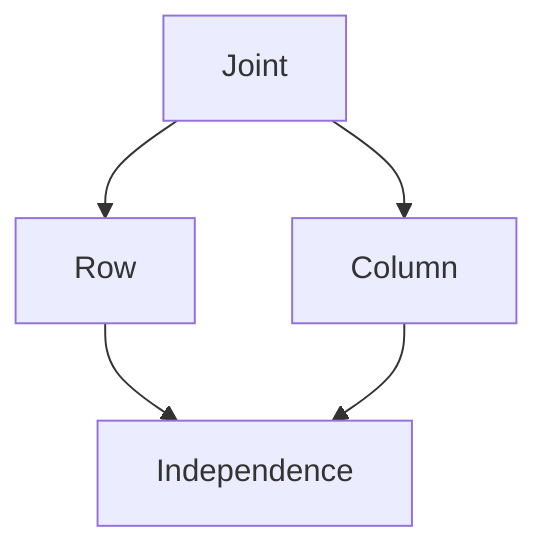

# Joint and Marginal Distributions
> A joint distribution describes several random variables together; marginal distributions describe each component separately.

## Formal definition
For random variables $X,Y:\Omega	o\mathbb{R}$ on a [[probability-space]], the joint distribution is the law of $(X,Y)$:
$$
\mathbb{P}_{(X,Y)}(A	imes B)=\mathbb{P}(X\in A,\,Y\in B),
$$
for Borel sets $A,B\in\mathcal{B}(\mathbb{R})$. The marginal distributions are $\mathbb{P}_X$ and $\mathbb{P}_Y$, obtained by ignoring the other coordinate.

## Intuition

## Relation to other ideas
- [[independence]] of $X$ and $Y$ requires the joint law to factor into the marginal laws.
- [[convolution-of-distributions]] combines independent marginals to find the law of a sum.
- [[variance-covariance-correlation]] uses joint behavior through $\mathbb{E}[XY]$.

## Pitfalls
- Matching marginals do not determine the joint distribution.
- Zero covariance is weaker than independence unless extra assumptions are available.

## Appears in
- [[stochastics-6-7]] p.6-p.12
- [[lecture-block-6-7-exercises]]

