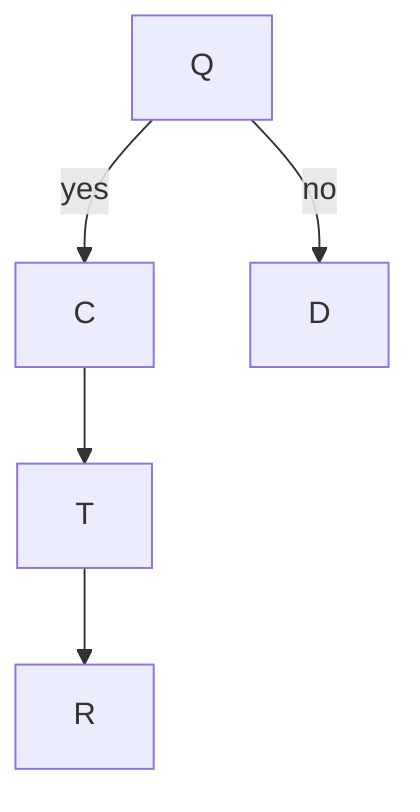

# Laplace Probability Space (*Laplace-Wahrscheinlichkeitsraum*)
> A finite probability model where all elementary outcomes are equally likely, so probabilities are ratios of counts.

## Formal definition

For a finite nonempty sample space $\Omega$, the Laplace probability is
$$\mathbb{P}(A)=\frac{|A|}{|\Omega|}\quad\text{for every }A\subseteq\Omega.
$$
Equivalently, every $\omega\in\Omega$ has point probability $p_\omega=1/|\Omega|$.

## Intuition

For a fair die, $\Omega=\{1,\ldots,6\}$ and
$$\mathbb{P}(\text{even})=\mathbb{P}(\{2,4,6\})=\frac{3}{6}=\frac12.
$$

For throwing a fair coin $n$ times, $\Omega=\{0,1\}^n$ and $\mathbb{P}(A)=|A|/2^n$.

## Relation to other ideas

- Often paired with [[combinatorial-counting]] because the probability task becomes a counting task.
- It is a special [[probability-distribution]] on a finite [[discrete-probability-space]].
- It appears in the dice and divisibility exercises in [[lecture-block-1-2-exercises]].

## Pitfalls

- Do not use a Laplace model if outcomes are not equally likely; the notes contrast it with an unfair coin.
- Choose $\Omega$ carefully. Ordered pairs for two dice give $36$ outcomes, not $21$ unordered outcomes, when the dice rolls are distinguished.

## Appears in

[[stochastics-1-2]], [[combinatorial-counting]], [[lecture-block-1-2-exercises]]

