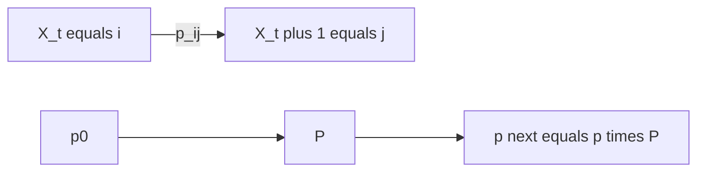

# Markov Chain
> A Markov chain is a [[stochastic-process]] whose next state depends on the past only through the present state.

## Formal definition

Let $(X_t)_{t\in\mathbb{N}_0}$ be a discrete-time stochastic process with at most countable state space $E$. The source calls real numbers $(p_{ij})_{i,j\in E}$ transition probabilities if
$$
\mathbb{P}(X_{t+1}=j\mid X_t=i)=p_{ij}
$$
for all $t\in\mathbb{N}_0$ and all $i,j\in E$ with $\mathbb{P}(X_t=i)>0$.

The Markov property is
$$
\mathbb{P}(X_t=i\mid X_{t_n}=i_n,\ldots,X_{t_1}=i_1)
=
\mathbb{P}(X_t=i\mid X_{t_n}=i_n),
$$
for $t_1<\cdots<t_n<t$ whenever the conditioning event has positive probability.

## Transition matrix

For finite $E=\{1,\ldots,m\}$, define
$$
P=\begin{pmatrix}
p_{11}&\cdots&p_{1m}\\
p_{m1}&\cdots&p_{mm}
\end{pmatrix},
\qquad
p(t)=\bigl(\mathbb{P}(X_t=1),\ldots,\mathbb{P}(X_t=m)\bigr).
$$
Then the source records the one-step update
$$
p(t+1)=p(t)P.
$$



## Procedure: propagate a finite Markov chain

```text
1. Choose the state order and write the row vector p(0).
2. Build the transition matrix P with entries p_ij.
3. For one step, compute p(t+1) = p(t) P.
4. For t steps, compute p(t) = p(0) P^t.
5. Interpret the resulting vector componentwise by state.
```

## Examples from the source

### Simple random walk

The simple random walk $(S_t)_{t\in\mathbb{N}_0}$ is a discrete-time Markov chain with
$$
p_{ij}=\begin{cases}
1/2,& j\in\{i-1,i+1\},\\
0,&\text{otherwise,}
\end{cases}
$$
for $i,j\in\mathbb{Z}$.

### Machine operable/inoperable chain

A machine has states `operable` and `inoperable`. Daily transitions are: if operable, it becomes inoperable with probability $1/10$; if inoperable, it becomes operable with probability $1/2$. With state order `(operable, inoperable)`,
$$
P=\begin{pmatrix}
9/10&1/10\\
1/2&1/2
\end{pmatrix},
\qquad p(0)=(1,0),
$$
and $p(t)=p(0)P^t$.

### Consecutive-heads chain

For repeated coin flips, let $X_t\in\{0,1,2\}$ be the number of successive heads by time $t$ until two successive heads have occurred. The source draws a three-state chain with state $2$ absorbing and transition matrix
$$
P=\begin{pmatrix}
1/2&1/2&0\\
1/2&0&1/2\\
0&0&1
\end{pmatrix}.
$$
Starting from $p(0)=(1,0,0)$, the notes compute
$$
p(1)=(1/2,1/2,0),\qquad p(2)=(1/2,1/4,1/4),
$$
and $p(t)\to(0,0,1)$.

### Two-state exercise from p.47

The second-half exercise uses state space $\{1,2\}$ and
$$
P=\begin{pmatrix}1/2&1/2\\1&0\end{pmatrix}.
$$
With $p(1)=(1/2,1/2)$, the row-vector update gives
$$
p(2)=p(1)P=(3/4,1/4).
$$
See [[statistical-inference-exercises]].

## Relation to other ideas

[[stochastic-process]] gives the general process language. [[independence]] is stronger than the Markov property: Markov chains remember the current state, while independent variables forget even that.

## Pitfalls

- Pairing a transition matrix with the wrong state order changes every interpretation.
- The update in these notes uses row vectors: $p(t+1)=p(t)P$.

## Appears in

[[stochastics-1]], [[stochastic-processes-and-statistics-exercises]], [[stochastic-process]]

