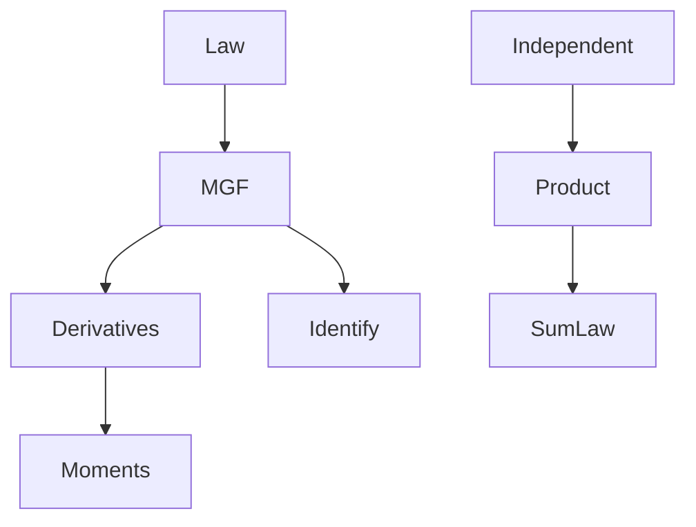

# Moment Generating Function
> A moment generating function (MGF) is the expectation $\mathbb{E}[e^{tX}]$; near zero it can identify the distribution and generate moments by differentiation.

## Formal definition

The source defines the MGF of a [[random-variable]] $X$ by
$$
M_X(t)=\mathbb{E}[e^{tX}],
$$
for real $t$ where this [[expectation]] is finite.

If $M_X(t)$ and $M_Y(t)$ exist on an interval $(-\varepsilon,\varepsilon)$ and agree there, then $X$ and $Y$ have the same distribution. If $M_X$ exists near $0$, then
$$
\mathbb{E}[X^m]=M_X^{(m)}(0),\qquad m\in\mathbb{N}.
$$

For independent $X$ and $Y$,
$$
M_{X+Y}(t)=M_X(t)M_Y(t)
$$
whenever the MGFs exist.

## Intuition



## Procedure

```text
1. Write M_X(t) = \mathbb{E}[e^{tX}] using the mass function or density.
2. Determine the t-values for which the sum or integral is finite, at least near 0.
3. Simplify the series or integral.
4. To compute moments, differentiate M_X(t) and evaluate at t = 0.
5. For an independent sum, multiply component MGFs.
6. Match the product to a known MGF to identify the sum distribution.
```

## MGFs appearing in the source

| Distribution | MGF in the source |
|---|---|
| [[poisson-distribution]]$(\lambda)$ | $M_X(t)=e^{\lambda(e^t-1)}$ |
| [[binomial-distribution]]$(n,p)$ | $M_X(t)=(pe^t+1-p)^n$ |
| [[bernoulli-distribution]]$(p)$ | $M_X(t)=pe^t+1-p$ |
| [[exponential-distribution]]$(\lambda)$ | $M_X(t)=\dfrac{\lambda}{\lambda-t}$ for $t<\lambda$ |
| [[uniform-distribution]]$((0,1))$ | $M_X(t)=\dfrac{e^t-1}{t}$ for $t\ne0$, and $M_X(0)=1$ |

## Examples from the source

- Independent Poisson variables add: multiplying $e^{\lambda(e^t-1)}$ and $e^{\mu(e^t-1)}$ gives $e^{(\lambda+\mu)(e^t-1)}$.
- If $X\sim\mathrm{Bin}(n,p)$ and independent $Y\sim\mathrm{Ber}(p)$, then
  $$
  M_{X+Y}(t)=(pe^t+1-p)^{n+1},
  $$
  hence $X+Y\sim\mathrm{Bin}(n+1,p)$.
- For independent $X,Y\sim U(0,1)$, $M_{X+Y}(t)=M_X(t)^2$.

## Relation to other ideas

- [[convolution-of-distributions]] is the direct density/mass-function method for the same sum problems.
- [[expectation]] and [[variance-covariance-correlation]] are recovered from first and second derivatives.
- [[central-limit-theorem]] is about limits of standardized sums, while MGFs identify finite sums when available.

## Pitfalls

- The MGF must exist in a neighborhood of $0$ for the uniqueness and moment-recovery statements used in the source.
- Multiplication requires [[independence]].

## Appears in

[[stochastics]], [[lecture-block-8-9-exercises]], [[poisson-distribution]], [[binomial-distribution]], [[exponential-distribution]], [[uniform-distribution]]

