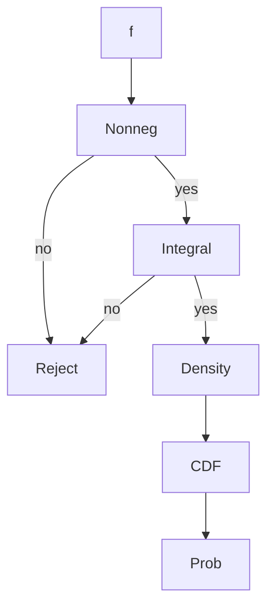

# Probability Density (*Dichte*)
> A density is a nonnegative function whose total integral is $1$ and whose integral over an interval gives probability.

## Formal definition

The notes call a function $f:\mathbb{R}\to\mathbb{R}$ a density if $f(x)\ge0$ for all $x\in\mathbb{R}$ and
$$
\int_{-\infty}^{\infty} f(x)\,dx=1.
$$
For such an $f$, the function
$$
F(y)=\int_{-\infty}^{y}f(x)\,dx
$$
is a [[cumulative-distribution-function]].

## Intuition



## Procedure: verify a density and compute its CDF

```text
1. Split the real line into the intervals where f has different formulas.
2. Check f(x) >= 0 on each interval.
3. Integrate f over all intervals and set the total equal to 1.
4. If a parameter is unknown, solve the normalization equation.
5. For each y-region, integrate f from -infinity to y using the appropriate pieces.
6. Check that the resulting CDF is nondecreasing and has limits 0 and 1.
```

## Examples from the source

- [[uniform-distribution]] on $[a,b]$: $f(x)=1/(b-a)$ for $x\in[a,b]$ and $0$ otherwise.
- [[pareto-distribution]]: $f(x)=\alpha x^{-\alpha-1}$ for $x\ge1$ and $0$ otherwise.
- [[exponential-distribution]]: $f(x)=\lambda e^{-\lambda x}$ for $x\ge0$ and $0$ otherwise.
- Standard [[normal-distribution]]: $\varphi(x)=\frac{1}{\sqrt{2\pi}}e^{-x^2/2}$.

## Relation to other ideas

- Densities define absolutely continuous laws, one class of [[probability-distribution]].
- [[expectation]] for a density uses $\int x f(x)\,dx$.
- [[variance-covariance-correlation|Variance]] uses $\int x^2f(x)\,dx$ together with the mean.

## Pitfalls

- A density value is not itself a probability; probabilities come from integrals.
- Nonnegativity and normalization must both be checked.
- Piecewise densities require piecewise CDF calculations.

## Appears in

[[stochastics-6-7]], [[cumulative-distribution-function]], [[uniform-distribution]], [[exponential-distribution]], [[normal-distribution]], [[pareto-distribution]]

