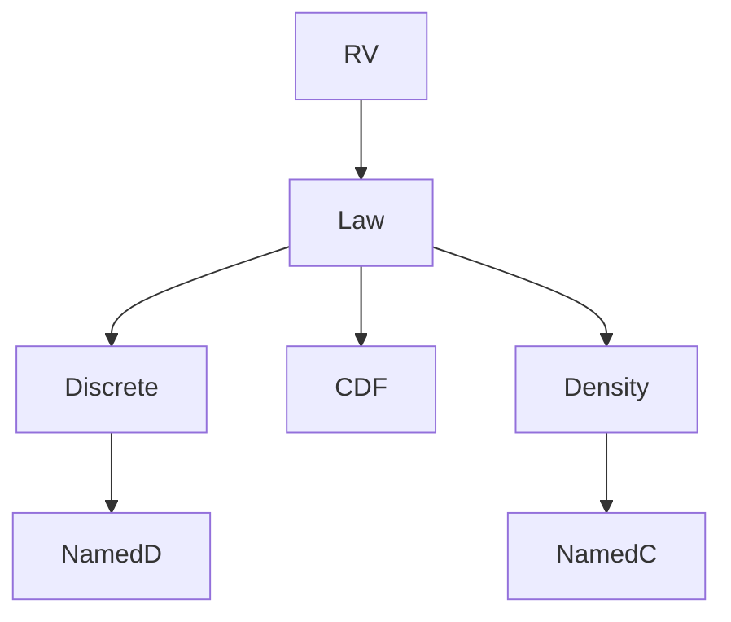

# Probability Distribution (*Wahrscheinlichkeitsverteilung*)
> A distribution describes the probabilities of a [[random-variable]], either by point masses, a CDF, or a density.

## Formal definition

For a [[random-variable]] $X:\Omega\to\mathbb{R}$ on $(\Omega,\mathcal{F},\mathbb{P})$, its distribution is
$$
\mathbb{P}_X(A)=\mathbb{P}(X^{-1}(A))=\mathbb{P}(\{\omega\in\Omega:X(\omega)\in A\})
$$
for [[borel-sigma-algebra|Borel sets]] $A\in\mathcal{B}(\mathbb{R})$.

In a discrete probability space, point masses determine all event probabilities:
$$
\mathbb{P}(A)=\sum_{\omega\in A}\mathbb{P}(\{\omega\}).
$$
Conversely, nonnegative masses $(p_\omega)$ summing to $1$ define a discrete probability space.

For real-valued variables, the same law can be represented by its [[cumulative-distribution-function]] $F_X(y)=\mathbb{P}(X\le y)$, and for absolutely continuous laws by a [[probability-density]] $f$ with $F_X(y)=\int_{-\infty}^{y}f(x)\,dx$.

## Intuition

## Relation to other ideas

- [[dirac-distribution]], [[geometric-distribution]], [[bernoulli-distribution]], [[binomial-distribution]], [[poisson-distribution]], [[hypergeometric-distribution]], and [[discrete-uniform-distribution]] are discrete laws.
- [[uniform-distribution]], [[exponential-distribution]], [[normal-distribution]], and [[pareto-distribution]] are introduced through densities.
- [[expectation]] and [[variance-covariance-correlation]] depend only on the distribution of the variable.

## Pitfalls

- For infinite discrete spaces, normalization is a series condition.
- A density value is not a probability; only integrals are probabilities.
- When transforming a variable, sum or integrate over all original values that map into the target event.

## Appears in

[[stochastics-1-2]], [[stochastics-4-5]], [[stochastics-6-7]], [[simulation-by-random-sampling]], [[lecture-block-6-7-exercises]]

