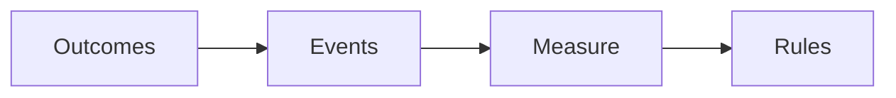

# Probability Space (*Wahrscheinlichkeitsraum*)
> A probability space is the general model consisting of outcomes, measurable events, and a probability measure.

## Formal definition

A probability space is a triple
$$
(\Omega,\mathcal{F},\mathbb{P})
$$
where:

- $\Omega\ne\varnothing$ is the sample space.
- $\mathcal{F}$ is a [[sigma-algebra]] on $\Omega$.
- $\mathbb{P}:\mathcal{F}\to[0,1]$ satisfies
  $$\mathbb{P}(\Omega)=1$$
  and, for disjoint $A_1,A_2,\ldots\in\mathcal{F}$,
  $$
  \mathbb{P}\left(\bigcup_{i=1}^{\infty}A_i\right)=\sum_{i=1}^{\infty}\mathbb{P}(A_i).
  $$

The source notes that for a [[discrete-probability-space]] $(\Omega,\mathbb{P})$ with $\mathcal{F}=\mathcal{P}(\Omega)$, the triple $(\Omega,\mathcal{F},\mathbb{P})$ is a probability space.

## Intuition

## Continuous example from the source

For $\Omega=\mathbb{R}$, $\mathcal{F}=\mathcal{B}(\mathbb{R})$, and
$$
\mathbb{P}(A)=\lambda_1(A\cap(0,1)),
$$
the source states that $(\Omega,\mathcal{B}(\mathbb{R}),\mathbb{P})$ is a probability space. Here $\lambda_1$ is the one-dimensional [[lebesgue-measure|Lebesgue measure]] introduced through [[borel-sigma-algebra|Borel sets]].

## Statistical model variant

stochastics-1.pdf p.14-p.16 uses probability spaces inside a statistical model
$$
(X,\mathcal{F}_X,(\mathbb{P}_\theta)_{\theta\in\Theta}),
$$
where each $(X,\mathcal{F}_X,\mathbb{P}_\theta)$ is a probability space and $\theta$ is the unknown parameter. This is the model language used by [[point-estimation]] and [[maximum-likelihood-estimation]].

## Relation to other ideas

- Extends [[discrete-probability-space]] beyond countable sample spaces.
- [[conditional-probability]], [[independence]], and [[random-variable|random variables]] are all defined inside a probability space.
- The measurable event set is controlled by [[sigma-algebra]].

## Pitfalls

- In the general setting, not every subset must be an event; only sets in $\mathcal{F}$ are assigned probabilities.
- Countable additivity applies to disjoint events in $\mathcal{F}$.

## Appears in

[[stochastics-4-5]], [[sigma-algebra]], [[random-variable]]

