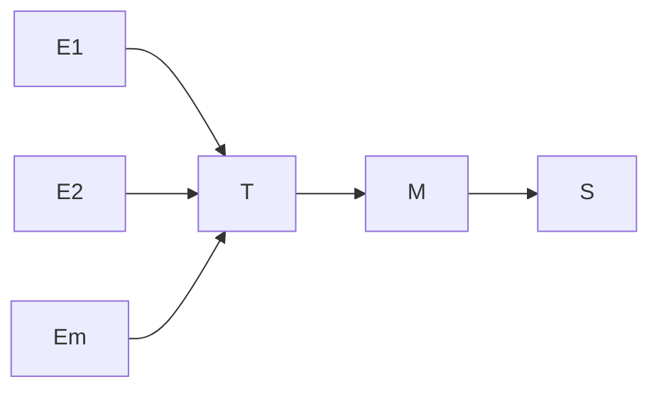

# Product Probability Space
> A product probability space models repeated experiments by multiplying the point probabilities of the component outcomes.

## Formal definition

For $m\in\mathbb{N}$ and discrete probability spaces $(\Omega_i,\mathbb{P}_i)$, $i=1,\ldots,m$, define
$$
\Omega=\prod_{i=1}^{m}\Omega_i.
$$
For $A\subseteq\Omega$,
$$
\mathbb{P}(A)=\sum_{(\omega_1,\ldots,\omega_m)\in A}\prod_{i=1}^{m}\mathbb{P}_i(\{\omega_i\}).
$$
Then $(\Omega,\mathbb{P})$ is a [[discrete-probability-space]].

## Intuition

The notes apply this to two fair die throws:
$$
\Omega=\{1,\ldots,6\}^2,
\qquad \mathbb{P}(A)=\sum_{(\omega_1,\omega_2)\in A}\frac{1}{36}=\frac{|A|}{36}.
$$

For an unfair coin tossed $n$ times with success probability $p$,
$$
\Omega=\{0,1\}^n,
$$
and a fixed sequence with $k$ successes and $n-k$ failures has probability
$$
p^k(1-p)^{n-k}.
$$

The traffic-light exercise uses the same repeated independent structure: four lights each independently allow passage or force a stop with probability $0.5$.

## Relation to other ideas

- Produces the point probabilities used in [[binomial-distribution]] when the order of successes is ignored.
- Gives concrete examples of [[independence]] between coordinate events.
- Underlies [[simulation-by-random-sampling]] for repeated coin tosses and the traffic-light exercise in [[lecture-block-4-5-exercises]].
- Depends on the [[probability-distribution]] of each coordinate.

## Pitfalls

- A fixed ordered sequence and the event "exactly $k$ successes" are different. The latter also requires counting the possible positions by $\binom{n}{k}$.
- Product construction assumes the coordinates use the intended independent repeated-experiment model; reinforced urns such as the Pólya exercise are not product spaces after the first draw.

## Appears in

[[stochastics-1-2]], [[stochastics-4-5]], [[lecture-block-1-2-exercises]], [[lecture-block-4-5-exercises]]

