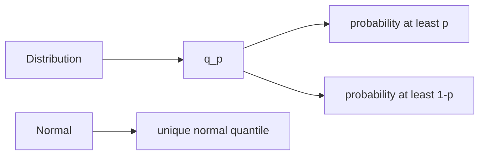

# Quantile
> A $p$-quantile is a threshold whose left probability is at least $p$ and whose right probability is at least $1-p$.

## Formal definition

For a [[random-variable]] $X$ and $p\in(0,1)$, a number $q_p\in\mathbb{R}$ is a $p$-quantile if
$$
\mathbb{P}(X\le q_p)\ge p
\quad\text{and}\quad
\mathbb{P}(X\ge q_p)\ge 1-p.
$$
For the standard [[normal-distribution]], the source writes the unique quantile as $z_p$ and defines it by
$$
\Phi(z_p)=p,
$$
where $\Phi$ is the standard normal CDF.

## Intuition

Quantiles turn probability levels into cutoffs. This is why $z_{1-\alpha}$ and $z_{1-\alpha/2}$ appear in [[confidence-intervals]] and [[hypothesis-testing]].

## Worked source example

For $X\sim\mathrm{Exp}(\lambda)$, the CDF is $F_X(q)=1-e^{-\lambda q}$. Therefore
$$
q_p=-\frac{\log(1-p)}{\lambda}.
$$
In the half-life example, the half-life is $8$ days, so $q_{1/2}=\log(2)/\lambda=8$ and $\lambda=\log(2)/8\approx0.0866$. The source then computes
$$
q_{1/4}=\frac{\log(4/3)}{\lambda}\approx3.32,
\qquad
q_{3/4}=\frac{\log(4)}{\lambda}\approx16.
$$

## Relation to other ideas

- [[cumulative-distribution-function]] gives the equation used to find a quantile.
- [[normal-distribution]] quantiles define Gaussian confidence intervals and tests.
- [[exponential-distribution]] quantiles model radioactive half-life examples in the source.

## Pitfalls

- Quantiles need not be unique for arbitrary distributions; the source explicitly says the standard normal quantile is unique.
- Keep the side conditions $\mathbb{P}(X\le q_p)\ge p$ and $\mathbb{P}(X\ge q_p)\ge1-p$ for discontinuous laws.

## Appears in

[[stochastics-1]], [[statistical-inference-exercises]], [[confidence-intervals]], [[hypothesis-testing]]

