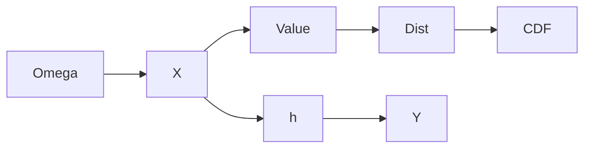

# Random Variable (*Zufallsvariable*)
> A random variable assigns a real number to each outcome in a measurable way and thereby induces its own distribution.

## Formal definition

For a general [[probability-space]] $(\Omega,\mathcal{F},\mathbb{P})$, a map $X:\Omega\to\mathbb{R}$ is a random variable if
$$
\{\omega\in\Omega:X(\omega)\in A\}\in\mathcal{F}\qquad\text{for every }A\in\mathcal{B}(\mathbb{R}).
$$
For a discrete probability space this measurability condition is automatic when $\mathcal{F}=\mathcal{P}(\Omega)$.

Its distribution is the pushforward probability measure
$$
\mathbb{P}_X(A)=\mathbb{P}(X^{-1}(A))=\mathbb{P}(\{\omega\in\Omega:X(\omega)\in A\}).
$$
For real-valued $X$, the [[cumulative-distribution-function]] is $F_X(y)=\mathbb{P}(X\le y)$.

## Indicator random variable

For $A\subseteq\Omega$, the indicator of $A$ is
$$
\mathbf{1}_A(\omega)=\begin{cases}1,&\omega\in A,\\0,&\omega\notin A.\end{cases}
$$
It has a [[bernoulli-distribution]] with $\mathbb{P}(\mathbf{1}_A=1)=\mathbb{P}(A)$ and [[expectation]] $\mathbb{E}[\mathbf{1}_A]=\mathbb{P}(A)$.

## Functions of random variables

If $h:\mathbb{R}\to\mathbb{R}$ is measurable and $X$ is a random variable, then $Y=h(X)$ is again a random variable. The source uses this for transformed variables such as $Y=X^2$ and $Y=2X$.

## Intuition



## Procedure: distribution of a transformed random variable

```text
1. Identify the transformation Y = h(X).
2. For discrete X, list all original values and group those with the same transformed value.
3. Sum the original probabilities within each group.
4. For continuous X, compute F_Y(y) = \mathbb{P}(h(X) <= y) or use the density/integral formula when applicable.
5. Check that the resulting probabilities or density are normalized.
```

## Worked examples from the sources

### Two children

With $\Omega=\{0,1\}^2$ and equal probabilities, define $X(\omega)$ as the number of male children. Then
$$
\mathbb{P}_X(\{0\})=\frac14,\qquad \mathbb{P}_X(\{1\})=\frac12,\qquad \mathbb{P}_X(\{2\})=\frac14.
$$

### Transforming $Y=X^2$

For the source table

| $x$ | $-2$ | $-1$ | $0$ | $1$ | $2$ |
|---|---:|---:|---:|---:|---:|
| $\mathbb{P}(X=x)$ | $0.1$ | $0.2$ | $0.1$ | $0.2$ | $0.4$ |

$Y=X^2$ has distribution $\mathbb{P}(Y=0)=0.1$, $\mathbb{P}(Y=1)=0.4$, and $\mathbb{P}(Y=4)=0.5$.

## Relation to other ideas

- The induced law is an update to [[probability-distribution]].
- CDFs and densities are recorded in [[cumulative-distribution-function]] and [[probability-density]].
- Indicators connect events with [[bernoulli-distribution]] and [[binomial-distribution]].
- Transforms are used in [[expectation]] and [[lecture-block-6-7-exercises]].

## Pitfalls

- A random variable value can have several preimages; probabilities must be summed over all of them.
- Measurability means inverse images of [[borel-sigma-algebra|Borel sets]] must be events.
- The distribution of $Y=X^2$ is not obtained by squaring probabilities.

## Appears in

[[stochastics-4-5]], [[stochastics-6-7]], [[lecture-block-4-5-exercises]], [[lecture-block-6-7-exercises]], [[probability-distribution]]

