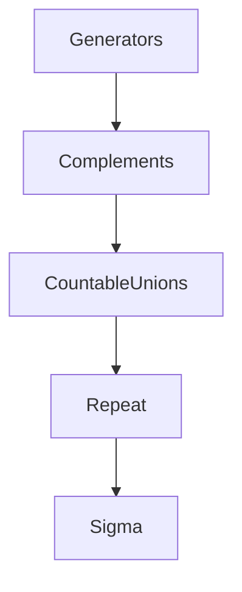

# Sigma Algebra (*σ-Algebra*)
> A sigma-algebra is the collection of subsets of $\Omega$ that are allowed to be treated as events.

## Formal definition

For a nonempty set $\Omega$, a family $\mathcal{F}\subseteq\mathcal{P}(\Omega)$ is a sigma-algebra on $\Omega$ if:

1. $\Omega\in\mathcal{F}$.
2. If $A\in\mathcal{F}$, then $A^c\in\mathcal{F}$.
3. If $A_1,A_2,\ldots\in\mathcal{F}$, then $\bigcup_{i=1}^{\infty}A_i\in\mathcal{F}$.

The source also records consequences: $\varnothing\in\mathcal{F}$, closure under finite unions, and closure under at most countable intersections.

## Generated sigma-algebra

For $A\subseteq\mathcal{P}(\Omega)$, $\sigma(A)$ is the smallest sigma-algebra on $\Omega$ that contains $A$.

Example from the source:
$$
\Omega=\{1,2,3,4\},\qquad A=\{\{1\}\},
$$
so
$$
\sigma(A)=\{\varnothing,\{1\},\{2,3,4\},\{1,2,3,4\}\}.
$$

## [[borel-sigma-algebra|Borel sigma-algebra]] and [[lebesgue-measure|Lebesgue measure]]

For $\Omega=\mathbb{R}$ and intervals $[a,b]$ with $a,b\in\mathbb{R}$ and $a\le b$,
$$
\mathcal{B}(\mathbb{R})=\sigma(\{[a,b]:a\le b\})
$$
is the [[borel-sigma-algebra|Borel sigma-algebra]] on $\mathbb{R}$. For $\Omega\subseteq\mathbb{R}^d$, the source defines the Borel sigma-algebra analogously using boxes
$$
\prod_{i=1}^d[a_i,b_i].
$$
The [[lebesgue-measure|Lebesgue measure]] $\lambda_d$ is introduced by
$$
\lambda_d\left(\prod_{i=1}^d[a_i,b_i]\right)=\prod_{i=1}^d(b_i-a_i)
$$
and countable additivity on disjoint Borel sets.

## Intuition

## Relation to other ideas

- A [[probability-space]] is built from $\Omega$, a sigma-algebra $\mathcal{F}$, and a probability measure $\mathbb{P}$.
- A [[random-variable]] must be compatible with the event structure; in the discrete-source definition it is a map $X:\Omega\to\mathbb{R}$.
- [[discrete-probability-space]] corresponds to the special case $\mathcal{F}=\mathcal{P}(\Omega)$.

## Pitfalls

- A sigma-algebra is not just any list of subsets; it must be closed under complements and countable unions.
- When asked for the smallest possible sigma-algebra, do not include unrelated subsets.

## Appears in

[[stochastics-4-5]], [[probability-space]], [[lecture-block-4-5-exercises]]

