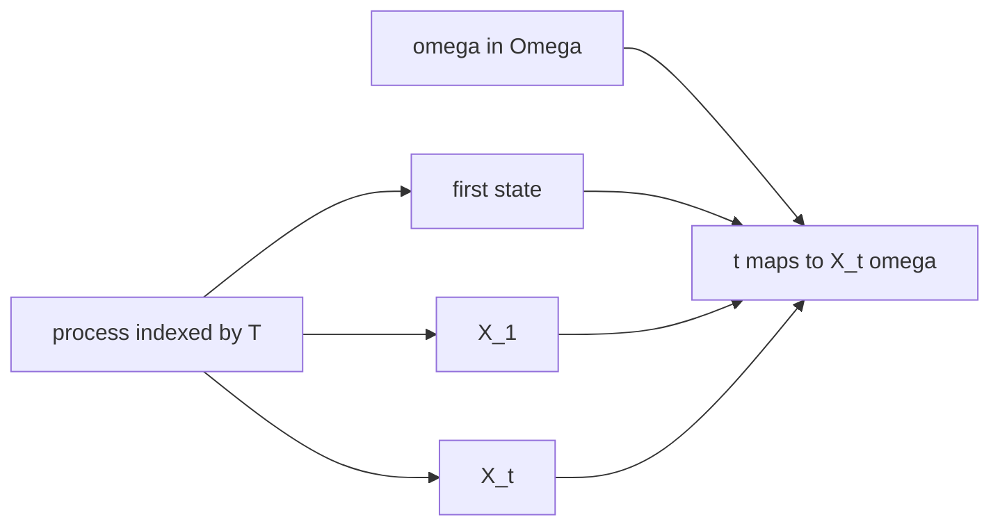

# Stochastic Process
> A stochastic process is a family of [[random-variable|random variables]] indexed by time or another parameter.

## Formal definition

Let $T\subseteq\mathbb{R}$ be an index set and let $E\subseteq\mathbb{R}$ be a state space. A stochastic process is a collection
$$
(X_t)_{t\in T}
$$
of random variables with values in $E$.
For each elementary outcome $\omega\in\Omega$, the map
$$
T\to E,\qquad t\mapsto X_t(\omega)
$$
is called a path.

The source uses the notation $T$ for the index set and $E$ for the state space.

## Intuition

A single random variable is one uncertain number. A stochastic process is an uncertain curve or sequence.

## Examples from the source

### Random walk from independent increments

For i.i.d. random variables $(X_i)_{i\in\mathbb{N}}$, define
$$
S_0=0,\qquad S_t=\sum_{i=1}^tX_i\quad(t\in\mathbb{N}).
$$
Then $(S_t)_{t\in\mathbb{N}_0}$ is a discrete-time stochastic process called a random walk. If $\mathbb{P}(X_1=1)=\mathbb{P}(X_1=-1)=1/2$, the source calls it a simple random walk.

### Independent increments

The process $(X_t)_{t\in T}$ has independent increments if for all $t_0<t_1<\cdots<t_n$ in $T$,
$$
X_{t_1}-X_{t_0},\;X_{t_2}-X_{t_1},\ldots, X_{t_n}-X_{t_{n-1}}
$$
are independent.

## Mean and covariance functions

For an integrable process $(X_t)_{t\in T}$, the formula summary records the process-level summaries
$$
\mu(t)=\mathbb{E}[X_t],\qquad \rho(s,t)=\mathrm{Cov}(X_s,X_t).
$$
These are the time-indexed analogues of [[expectation]] and [[variance-covariance-correlation]].

## Relation to other ideas

- [[markov-chain]] is the discrete-time, countable-state Markov special case.
- [[poisson-process]] and [[brownian-motion]] are continuous-time processes with independent increments.
- Mean and covariance functions extend [[expectation]] and [[variance-covariance-correlation]] from single variables to processes.

## Pitfalls

- The index set $T$ is not necessarily the state space. $T$ labels time; $E$ contains possible values.
- A process is not one random variable but an indexed family of random variables.

## Appears in

[[stochastics-1]], [[markov-chain]], [[poisson-process]], [[brownian-motion]], [[stochastic-processes-and-statistics-exercises]]

