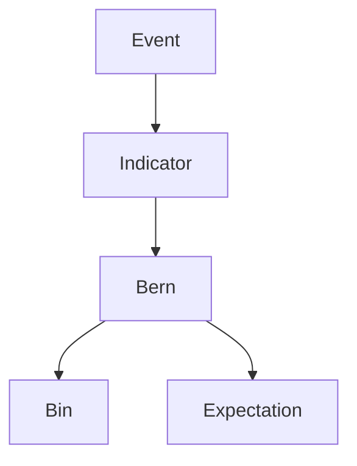

# Bernoulli Distribution

| Item | Value from source |
|---|---|
| Support | $\{0,1\}$ |
| PMF/PDF | $\mathbb{P}(X=1)=p$, $\mathbb{P}(X=0)=1-p$ |
| CDF | $0$ for $y<0$; $1-p$ for $0\le y<1$; $1$ for $y\ge1$ |
| $\mathbb{E}[X]$ | $p$ for an indicator of an event of probability $p$ |
| $\mathrm{Var}(X)$ | Not explicitly given for a single Bernoulli variable; used as $p-p^2$ in the binomial variance derivation |
| MGF | $pe^t+1-p$ |
| Parameters | $p\in[0,1]$ |

## Story / when it arises

The lecture uses Bernoulli variables for success/failure outcomes and indicators. For an event $A$,
$$
\mathbf{1}_A=\begin{cases}1,&A\text{ occurs},\\0,&A\text{ does not occur},\end{cases}
$$
so $\mathbb{E}[\mathbf{1}_A]=\mathbb{P}(A)$.

## Relationships

## Typical exercise patterns

- Convert event probabilities into expectations of indicators.
- Represent a [[binomial-distribution]] variable as $X=\sum_{i=1}^n\mathbf{1}_{A_i}$.
- Use indicator variances and independence to compute binomial variance.
- Use the MGF $pe^t+1-p$ to show that adding an independent Bernoulli$(p)$ to a binomial$(n,p)$ gives a binomial$(n+1,p)$.
- For i.i.d. Bernoulli$(p)$ variables, the product $\prod_{i=1}^nY_i$ converges in probability to $0$ when $0<p<1$.

## See also

[[random-variable]], [[expectation]], [[binomial-distribution]], [[variance-covariance-correlation]], [[convergence-of-random-variables]], [[stochastics-6-7]], [[stochastics]]

