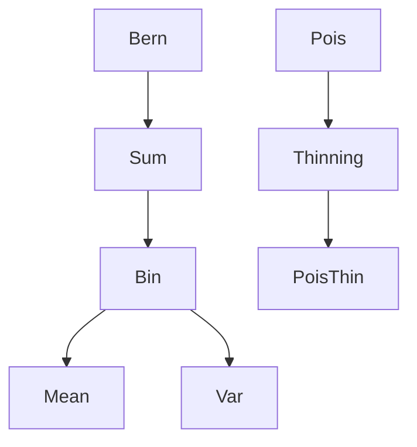

# Binomial Distribution

| Item | Value from source |
|---|---|
| Support | $\{0,\ldots,n\}$ |
| PMF/PDF | $\mathbb{P}(X=k)=\binom{n}{k}p^k(1-p)^{n-k}$ |
| CDF | Not given in this source |
| $\mathbb{E}[X]$ | $np$ |
| $\mathrm{Var}(X)$ | $np(1-p)$ |
| MGF | $(pe^t+1-p)^n$ |
| Parameters | $n\in\mathbb{N}$, $p\in[0,1]$ |

## Story / when it arises

The notes interpret $X$ as the number of successes in $n$ repeated success/failure trials. A fixed order of $k$ successes has probability $p^k(1-p)^{n-k}$, and [[combinatorial-counting]] gives $\binom{n}{k}$ possible success positions.

Block 6-7 derives the mean by writing $X=\sum_{i=1}^n\mathbf{1}_{A_i}$ for success events $A_i$, so [[expectation|linearity of expectation]] gives $\mathbb{E}[X]=np$. For independent trials, the covariance terms vanish and $\mathrm{Var}(X)=np(1-p)$.

## Relationships

## Typical exercise patterns

- Count exactly $k$ successes among $n$ trials.
- Use indicators for mean and variance.
- In Poisson thinning, condition on a Poisson count and apply a binomial conditional distribution.

## Additional results from stochastics.pdf

The later source shows that if $X\sim\mathrm{Bin}(n,p)$ and independent $Y\sim\mathrm{Ber}(p)$, then $X+Y\sim\mathrm{Bin}(n+1,p)$, by both [[convolution-of-distributions]] and [[moment-generating-function|MGFs]]. It also applies [[de-moivre-laplace-theorem]] and [[normal-approximation]] to $X\sim\mathrm{Bin}(900,1/6)$.

## Testing use from stochastics-1.pdf

The statistics notes use binomial upper tails for the exact one-sided test of
$$
H_0:p\le p_0\quad\text{against}\quad H_1:p>p_0.
$$
The rejection rule uses $S=\sum_iX_i$ and a cutoff $m_0$ with
$$
\sum_{k=m_0+1}^n {n\choose k}p_0^k(1-p_0)^{n-k}\le\alpha.
$$
See [[hypothesis-testing]].

## See also

[[bernoulli-distribution]], [[product-probability-space]], [[random-variable]], [[expectation]], [[variance-covariance-correlation]], [[poisson-distribution]], [[hypergeometric-distribution]], [[lecture-block-6-7-exercises]], [[stochastics]]

