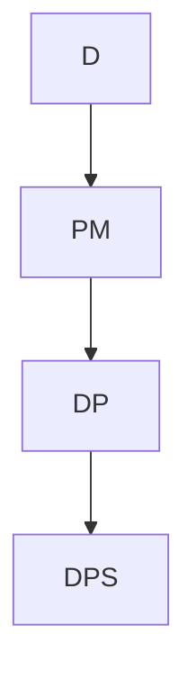

# Dirac Distribution

| Item | Value from source |
|---|---|
| Support | At most countable $\Omega$ with fixed $\omega_0\in\Omega$ |
| PMF/PDF | $p_\omega=1$ if $\omega=\omega_0$, and $p_\omega=0$ otherwise |
| CDF | Not given in this source |
| $\mathbb{E}[X]$ | Not given in this source |
| $\mathrm{Var}(X)$ | Not given in this source |
| MGF | Not given in this source |
| Parameters | Fixed point $\omega_0$ |

## Story / when it arises

The Dirac distribution assigns all probability mass to one outcome. For any event $A\subseteq\Omega$,
$$\mathbb{P}(A)=
\begin{cases}
1, & \omega_0\in A,\\
0, & \omega_0\notin A.
\end{cases}
$$

## Relationships

## Typical exercise patterns

- Check nonnegativity and that total mass is $1$.
- Evaluate events by asking whether $\omega_0$ belongs to the event.

## See also

[[probability-distribution]], [[discrete-probability-space]], [[stochastics-1-2]]

