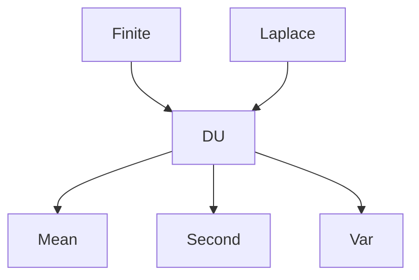

# Discrete Uniform Distribution

| Item | Value from source |
|---|---|
| Support | $\{1,\ldots,n\}$ |
| PMF/PDF | $\mathbb{P}(X=k)=1/n$ for $k=1,\ldots,n$ |
| CDF | Not given in this source |
| $\mathbb{E}[X]$ | $(n+1)/2$ |
| $\mathrm{Var}(X)$ | The notes start from $\mathbb{E}[X^2]=\frac{1}{n}\sum_{k=1}^n k^2$; simplifying gives $(n^2-1)/12$ |
| MGF | Not given in this source |
| Parameters | $n\in\mathbb{N}$ |

## Story / when it arises

The exercise computes the mean by averaging the values $1,\ldots,n$:
$$
\mathbb{E}[X]=\sum_{k=1}^n k\frac1n=\frac{n+1}{2}.
$$
For variance, the notes use $\mathbb{E}[X^2]=\frac1n\sum_{k=1}^n k^2$.

## Relationships

## Typical exercise patterns

- Sum arithmetic series for the mean.
- Sum squares for the second moment.
- Apply $\mathrm{Var}(X)=\mathbb{E}[X^2]-\mathbb{E}[X]^2$.

## See also

[[laplace-probability-space]], [[expectation]], [[variance-covariance-correlation]], [[lecture-block-6-7-exercises]]

