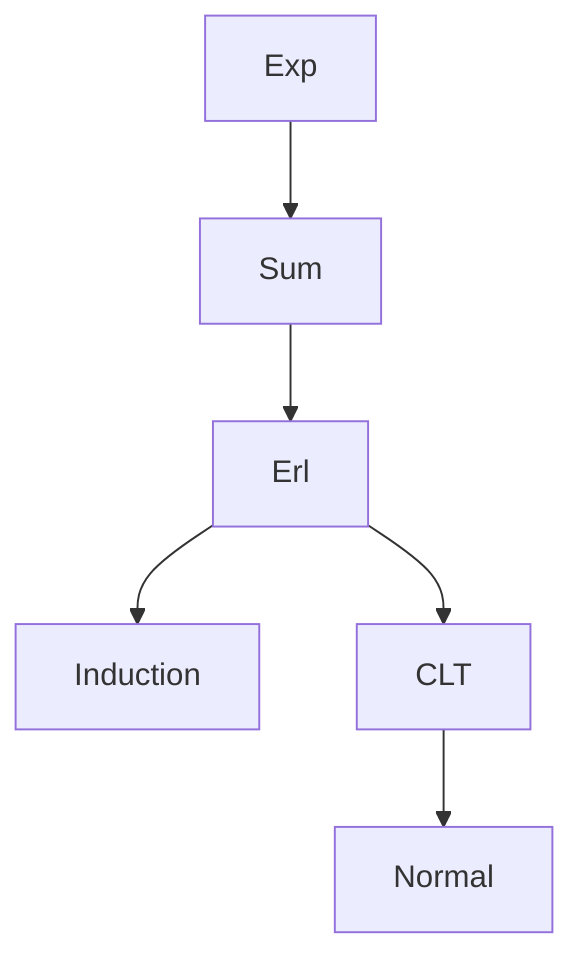

# Erlang Distribution

| Item | Value from source |
|---|---|
| Support | $(0,\infty)$, with density $0$ elsewhere |
| PMF/PDF | $f(x)=\dfrac{\lambda^n x^{n-1}}{(n-1)!}e^{-\lambda x}$ for $x>0$ |
| CDF | Not given explicitly in this source |
| $\mathbb{E}[X]$ | $n/\lambda$ follows from sum of exponentials and the source's exponential mean |
| $\mathrm{Var}(X)$ | $n/\lambda^2$ follows from sum of independent exponentials and source variance |
| MGF | Not given explicitly in this source |
| Parameters | $\lambda>0$, $n\in\mathbb{N}$ |

## Story / when it arises

The source defines the Erlang distribution $\mathrm{Erl}(\lambda,n)$ by its density and proves that it is the distribution of a sum of $n$ independent [[exponential-distribution|exponential]]$(\lambda)$ variables.

## Relationships



## Convolution identity from the source

If $X\sim\mathrm{Erl}(\lambda,n)$ and $Y\sim\mathrm{Exp}(\lambda)$ are independent, then
$$
X+Y\sim\mathrm{Erl}(\lambda,n+1).
$$
The source computes for $t>0$
$$
f_{X+Y}(t)=\int_{0}^{t}
\frac{\lambda^n(t-s)^{n-1}}{(n-1)!}e^{-\lambda(t-s)}\lambda e^{-\lambda s}\,ds
=\frac{\lambda^{n+1}t^n}{n!}e^{-\lambda t}.
$$

## Typical exercise patterns

```text
1. Identify independent exponential(lambda) waiting times X_1, ..., X_n.
2. For n = 1, recognize Exp(lambda) as Erlang(lambda, 1).
3. Use convolution with one more Exp(lambda) to increase the shape n by one.
4. For large n, standardize the sum with mean n/lambda and standard deviation sqrt(n)/lambda.
5. Apply the central limit theorem if an approximate normal law is requested.
```

## See also

[[exponential-distribution]], [[convolution-of-distributions]], [[central-limit-theorem]], [[stochastics]], [[lecture-block-8-9-exercises]]

