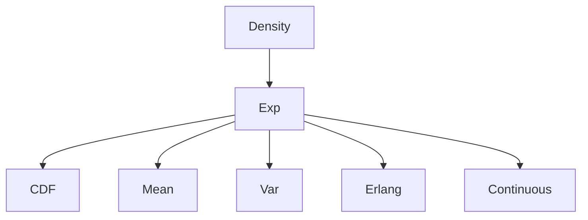

# Exponential Distribution

| Item | Value from source |
|---|---|
| Support | $[0,\infty)$ |
| PMF/PDF | $f(x)=\lambda e^{-\lambda x}$ for $x\ge0$, $0$ for $x<0$ |
| CDF | $F(y)=0$ for $y<0$; $1-e^{-\lambda y}$ for $y\ge0$ |
| $\mathbb{E}[X]$ | $1/\lambda$ |
| $\mathrm{Var}(X)$ | $1/\lambda^2$ |
| MGF | $\lambda/(\lambda-t)$ for $t<\lambda$ |
| Parameters | $\lambda>0$ |

## Story / when it arises

The notes introduce the exponential law as a continuous distribution with a one-sided decreasing density. Its CDF is obtained by integrating the density from $0$ to $y$.

## Relationships

## Typical exercise patterns

- Integrate the density to get the CDF.
- Use integration by parts to compute $\mathbb{E}[X]=1/\lambda$.
- Keep support restrictions: $f(x)=0$ for $x<0$.

## Additional results from stochastics.pdf

The later source adds the MGF and moments:
$$
M_X(t)=\frac{\lambda}{\lambda-t},\qquad t<\lambda,
$$
$$
\mathbb{E}[X^\ell]=\frac{\ell!}{\lambda^\ell},\qquad \mathrm{Var}(X)=\frac1{\lambda^2}.
$$
It also shows that sums of independent exponential variables have an [[erlang-distribution]], and that $X_n\sim\mathrm{Exp}(n)$ satisfies $X_n\xrightarrow{P}0$.

## Quantiles and half-life from stochastics-1.pdf

The p.35-p.36 exercise solves $1-e^{-\lambda q_p}=p$, giving
$$
q_p=-\frac{\log(1-p)}{\lambda}.
$$
If the half-life is $8$ days, then $\lambda=\log(2)/8\approx0.0866$, so
$$
q_{1/4}=\frac{\log(4/3)}{\lambda}\approx3.32,
\qquad
q_{3/4}=\frac{\log(4)}{\lambda}\approx16.
$$
See [[quantile]].

## See also

[[probability-density]], [[cumulative-distribution-function]], [[expectation]], [[erlang-distribution]], [[stochastics-6-7]], [[stochastics]]

