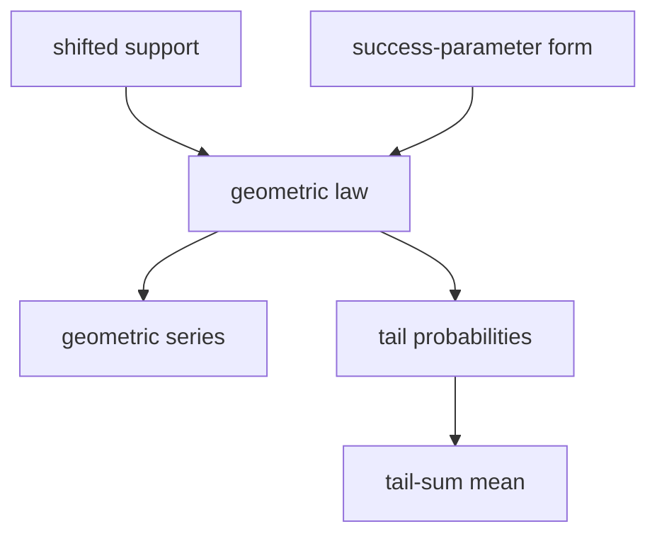

# Geometric Distribution

The wiki's primary convention is the one used most consistently in the TUHH notes: $X$ counts failures before the first success and the parameter $p$ is the continuation/failure probability.

| Item | Primary TUHH convention |
|---|---|
| Support | $\mathbb{N}_0=\{0,1,2,\ldots\}$ |
| PMF/PDF | $\mathbb{P}(X=k)=p^k(1-p)$ for $k\in\mathbb{N}_0$, $p\in(0,1)$ |
| CDF | $F_X(k)=1-p^{k+1}$ for integer $k\ge0$ |
| $\mathbb{E}[X]$ | $p/(1-p)$ |
| $\mathrm{Var}(X)$ | $p/(1-p)^2$ |
| MGF | $M_X(t)=(1-p)/(1-pe^t)$ for $pe^t<1$ |
| Parameters | $p$ is the probability that the waiting continues one more step; success probability is $1-p$ |

## Story / when it arises

The notes use the $\mathbb{N}_0$ version as the number of failures before the first success. The mass function is normalized by the geometric series
$$
\sum_{k=0}^{\infty}p^k(1-p)=1.
$$

Block 6-7 applies the [[tail-sum-formula]]. Since $\mathbb{P}(X\ge a)=p^a$ for $a\ge1$,
$$
\mathbb{E}[X]=\sum_{a=1}^{\infty}p^a=\frac{p}{1-p}.
$$

A shifted version with first possible value $m$ has, in the primary convention,
$$
\mathbb{P}(X=k)=p^{k-m}(1-p),\qquad k=m,m+1,\ldots.
$$

## Formula-summary warning

> ?? Note: `stochastics_formulas.pdf` p.1 lists the same PMF $\mathbb{P}(X=k)=p^k(1-p)$ on $\mathbb{N}_0$ but then states $\mathbb{E}[X]=1/p$ and a variance proportional to $p(1-p)$. Those moments are inconsistent with the displayed PMF. For the displayed PMF, the correct moments are $\mathbb{E}[X]=p/(1-p)$ and $\mathrm{Var}(X)=p/(1-p)^2$. The value $1/p$ belongs to a different convention only if $p$ is the success probability and the variable counts trials starting at $1$.

## Alternative convention and conversion

Many books instead use a success-probability parameter $q$ on $\mathbb{N}_0$:
$$
\mathbb{P}(Y=k)=(1-q)^kq,\qquad k\in\mathbb{N}_0.
$$
This is the same law after the conversion
$$
q=1-p,\qquad p=1-q,\qquad Y=X.
$$
Under that convention,
$$
\mathbb{E}[Y]=\frac{1-q}{q},\qquad
\mathrm{Var}(Y)=\frac{1-q}{q^2}.
$$
If the variable counts the trial number $T=Y+1$ instead of failures, then $T\in\{1,2,\ldots\}$ and
$$
\mathbb{P}(T=t)=(1-q)^{t-1}q,\qquad
\mathbb{E}[T]=\frac1q,\qquad
\mathrm{Var}(T)=\frac{1-q}{q^2}.
$$

## Maximum-likelihood example

The p.25-p.26 [[maximum-likelihood-estimation]] example uses the primary TUHH convention:
$$
L_x(p)=\prod_{i=1}^n p^{x_i}(1-p),
\qquad x_i\in\mathbb{N}_0.
$$
The score equation gives
$$
\hat p=\frac{\bar{X}_n}{1+\bar{X}_n}.
$$
The earlier p.25 reading that suggested $p(1-p)^x$ is treated as the alternative success-parameter convention above; [[open-questions]] records this as resolved.

## Convolution example from stochastics-1.pdf

If $Y$ has the geometric law $\mathbb{P}(Y=k)=2^{-(k+1)}$ on $\mathbb{N}_0$ and $Z\sim\mathrm{Ber}(1/2)$ is independent, then the source computes
$$
\mathbb{P}(Y+Z=0)=\frac14,
\qquad
\mathbb{P}(Y+Z=\ell)=\frac{3}{2^{\ell+2}},\quad \ell>0.
$$
This is a discrete [[convolution-of-distributions]] pattern.

## Relationships

## Typical exercise patterns

- Verify nonnegativity and sum point masses with a geometric series.
- Use tail probabilities to compute expectation.
- Check whether $p$ means continuation probability or success probability before differentiating a likelihood.
- Convert alternative formulas with $q=1-p$ before comparing results.

## See also

[[probability-distribution]], [[expectation]], [[tail-sum-formula]], [[maximum-likelihood-estimation]], [[convolution-of-distributions]], [[lecture-block-1-2-exercises]], [[lecture-block-6-7-exercises]], [[stochastics-6-7]], [[stochastics-1]]

