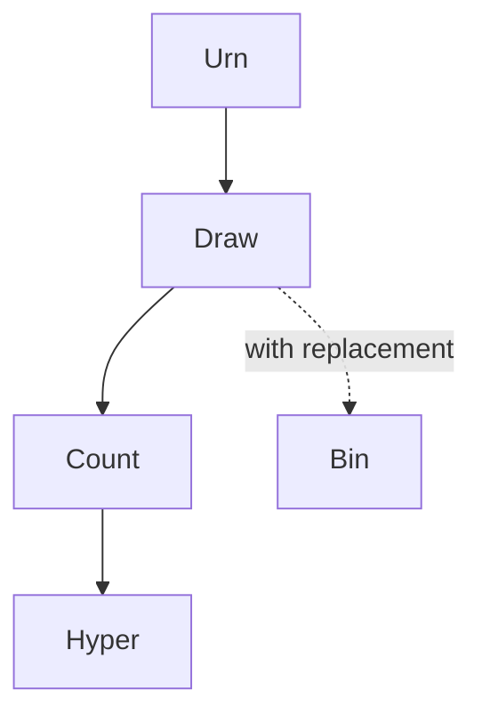

# Hypergeometric Distribution

| Item | Value from source |
|---|---|
| Support | $k\in\{0,\ldots,n\}$, subject to feasible color counts |
| PMF/PDF | $\mathbb{P}(X=k)=\dfrac{\binom{b}{k}\binom{r}{n-k}}{\binom{b+r}{n}}$ |
| CDF | Not given in this source |
| $\mathbb{E}[X]$ | Not given in this source |
| $\mathrm{Var}(X)$ | Not given in this source |
| MGF | Not given in this source |
| Parameters | $b$ blue balls, $r$ red balls, $n$ draws without replacement |

## Story / when it arises

The source introduces the hypergeometric distribution through an urn containing $b$ blue balls and $r$ red balls. Draw $n$ balls without replacement and let $X$ be the number of drawn blue balls. Then the probability of exactly $k$ blue balls is
$$
\mathbb{P}(X=k)=\frac{\binom{b}{k}\binom{r}{n-k}}{\binom{b+r}{n}}.
$$

## Relationships

## Typical exercise patterns

- Count favorable samples by choosing $k$ blue balls and $n-k$ red balls.
- Divide by all size-$n$ draws from $b+r$ balls.
- Compare to [[binomial-distribution]] when replacement or independent trials are used instead.

## See also

[[combinatorial-counting]], [[random-variable]], [[binomial-distribution]], [[stochastics-4-5]]

