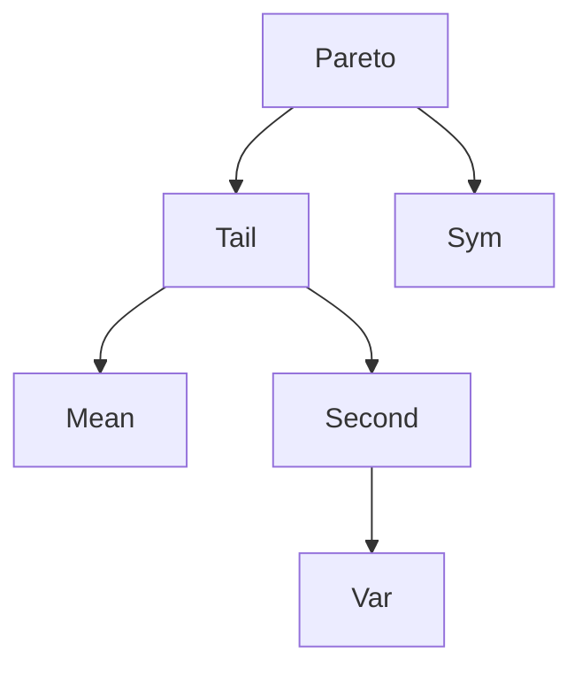

# Pareto Distribution

| Item | Value from source |
|---|---|
| Support | $[1,\infty)$ |
| PMF/PDF | $f(x)=\alpha x^{-\alpha-1}$ for $x\ge1$, $0$ for $x<1$ |
| CDF | $F(y)=0$ for $y<1$; $1-y^{-\alpha}$ for $y\ge1$ |
| $\mathbb{E}[X]$ | $\alpha/(\alpha-1)$ for $\alpha>1$ |
| $\mathrm{Var}(X)$ | finite for $\alpha>2$; from the source moments, $\alpha/((\alpha-2)(\alpha-1)^2)$ |
| MGF | Not given in this source |
| Parameters | $\alpha>0$ |

## Story / when it arises

The source verifies that $f(x)=\alpha x^{-\alpha-1}$ for $x\ge1$ is a density and integrates it to obtain
$$
F(y)=\begin{cases}0,&y<1,\\1-y^{-\alpha},&y\ge1.\end{cases}
$$
Exercise block 7 computes moments and shows that higher moments require stronger assumptions.

## Relationships

## Typical exercise patterns

- Check normalization by integrating $\alpha x^{-\alpha-1}$ from $1$ to $\infty$.
- Compute a moment and inspect whether the boundary term at $\infty$ vanishes.
- Separate the cases $\alpha>1$ for the mean and $\alpha>2$ for variance.

## Estimation use from stochastics-1.pdf

For $X\sim$ Pareto$(\alpha)$, the source shows that $T(X)=1/X$ is unbiased for $\alpha/(\alpha+1)$:
$$
\mathbb{E}_\alpha\left[\frac1X\right]
=\int_1^\infty \frac1x\alpha x^{-\alpha-1}\,dx
=\frac{\alpha}{\alpha+1}.
$$
This is an example for [[point-estimation]].

## See also

[[probability-density]], [[cumulative-distribution-function]], [[expectation]], [[variance-covariance-correlation]], [[lecture-block-6-7-exercises]]

