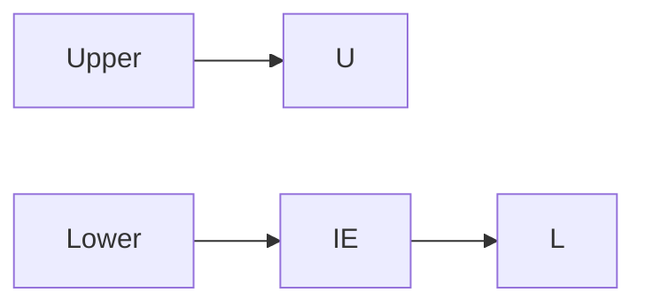
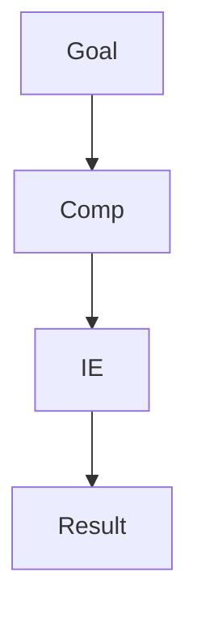

# Lecture Block 1-2 Exercises

This page groups the worked exercise patterns from [[stochastics-1-2]]. They use [[discrete-probability-space]], [[laplace-probability-space]], [[probability-rules]], [[inclusion-exclusion-principle]], [[combinatorial-counting]], and [[probability-distribution]].

## Exercise: bounds for intersections

Problem: Let $A,B\subseteq\Omega$ with $\mathbb{P}(A)=0.7$ and $\mathbb{P}(B)=0.6$. Determine possible cases and show
$$
0.3\le \mathbb{P}(A\cap B)\le 0.6.
$$

Solution pattern:

```text
1. For the upper bound, use A cap B subseteq B.
2. Conclude \mathbb{P}(A cap B) <= \mathbb{P}(B) = 0.6.
3. For the lower bound, use \mathbb{P}(A union B) <= 1.
4. Apply \mathbb{P}(A union B)=\mathbb{P}(A)+\mathbb{P}(B)-\mathbb{P}(A cap B).
5. Rearrange to \mathbb{P}(A cap B) >= 0.7+0.6-1=0.3.
```



## Exercise: two throws of a six-sided die

Sample space:
$$
\Omega=\{1,\ldots,6\}^2,
\qquad \mathbb{P}(A)=\frac{|A|}{36}.
$$

Events in the notes:

| Event | Count | Probability |
|---|---:|---:|
| The number $3$ occurs exactly once | $10$ | $10/36$ |
| The second roll is prime, i.e. in $\{2,3,5\}$ | $6\cdot 3=18$ | $18/36=1/2$ |
| The sum is at most $11$ | complement is $(6,6)$ only | $35/36$ |

General takeaway: define the ordered sample space first; then describe events as subsets of ordered pairs.

## Exercise: strictly and weakly increasing sequences

For $n$ elements $c_i\in\{1,\ldots,p\}$:

- Strictly increasing sequences $c_1<\cdots<c_n$ are unordered selections without replacement, so the count is $\binom{p}{n}$.
- Weakly increasing sequences $c_0\le c_1\le\cdots\le c_n$ with replacement are counted by $\binom{p+n-1}{n}$ in the source's stars-and-bars form.

This is an application of [[combinatorial-counting]].

## Exercise: divisibility by $2$, $3$, or $19$

Problem: Choose uniformly from $\{1,\ldots,1{,}000{,}000\}$. Find the probability that the chosen number is divisible by $2$, $3$, or $19$.

Set
$$
A_2=\{a:2\mid a\},\quad A_3=\{a:3\mid a\},\quad A_{19}=\{a:19\mid a\}.
$$
Then apply [[inclusion-exclusion-principle]] to $A_2\cup A_3\cup A_{19}$. The notes record the resulting probability as approximately $0.648$.

```text
1. Count multiples of each divisor.
2. Count multiples of each pairwise least common multiple.
3. Count multiples of the triple least common multiple.
4. Add single counts, subtract pair counts, add the triple count.
5. Divide by 1,000,000.
```

## Exercise: five-digit numbers

The source studies strings from $00000$ to $99999$ and counts equality patterns among the five positions. Readable subcases include:

- all digits equal: $\binom{10}{1}=10$;
- exactly four digits equal and the remaining digit different: $\binom{10}{1}\binom{5}{4}\binom{9}{1}=450$;
- exactly three digits equal and the remaining two are different from each other;
- exactly three digits equal and the remaining two are equal;
- exactly two digits equal and the remaining three are different;
- two distinct equal pairs plus one different digit;
- five different digits.

> WARNING: Unreadable in source: Stochastics_1_2.pdf p.12 — parts of the formulas for later five-digit subcases are scribbled over and should be checked against the original exercise sheet.

## Exercise: bus stops occupancy

Problem: Seven passengers are on a bus and there are four remaining stops. Assume each passenger independently chooses one of the four stops. Find the probability that at least one passenger gets off at each stop.

Sample space:
$$
\Omega=\{1,2,3,4\}^7,
\qquad \mathbb{P}(A)=\frac{|A|}{4^7}.
$$

Let $B_i$ be the event that stop $i$ receives at least one passenger. The desired event is $B_1\cap B_2\cap B_3\cap B_4$. Its complement is $B_1^c\cup B_2^c\cup B_3^c\cup B_4^c$, so the notes use inclusion-exclusion and record the final probability as approximately $0.513$.



## Exercise: largest selected number in repeated urn draws

Problem: An urn contains $n$ balls numbered $1$ to $n$. Draw with replacement $r$ times. Find the probability that the largest selected number is $m\in\{1,\ldots,n\}$.

Sample space:
$$
\Omega=\{1,\ldots,n\}^r,
\qquad \mathbb{P}(A)=\frac{|A|}{n^r}.
$$

Let $B_m$ be the event that all $r$ draws are at most $m$. Then $|B_m|=m^r$ and
$$\mathbb{P}(\max=m)=\mathbb{P}(B_m\setminus B_{m-1})
=\frac{m^r-(m-1)^r}{n^r}.
$$

## Exercise: shifted geometric distribution

For $p\in(0,1)$ and $m\in\mathbb{N}_0$, show that
$$\mathbb{P}(A)=\sum_{k\in A}(1-p)^{k-m}p
$$
defines a [[probability-distribution]] on $\{m,m+1,\ldots\}$.

The proof checks nonnegativity and total mass:
$$
\sum_{k=m}^{\infty}(1-p)^{k-m}p=p\sum_{s=0}^{\infty}(1-p)^s=1.
$$

## Exercise: simulating fair coin tosses

The source simulates $1{,}000{,}000$ fair coin tosses and plots block frequencies. The theoretical comparison is [[binomial-distribution]] with $p=0.5$:
$$\mathbb{P}(A)=\sum_{k\in A}\binom{n}{k}0.5^k0.5^{n-k}.
$$

See [[simulation-by-random-sampling]] for the procedure.

