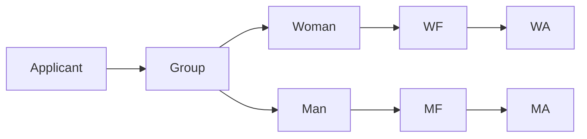

# Lecture Block 4-5 Exercises

These worked patterns collect the exercises and examples from [[stochastics-4-5]]. They mainly practice [[conditional-probability]], [[law-of-total-probability]], [[bayes-formula]], [[independence]], [[sigma-algebra]], and [[random-variable|random variables]].

## Machine defect rate

A randomly selected part comes from machine $M_1$ with probability $0.6$ and from $M_2$ with probability $0.4$. The defect probabilities are $0.05$ and $0.10$.

Solution pattern:
$$
\mathbb{P}(\text{defect})=0.05\cdot0.6+0.10\cdot0.4=0.07.
$$

Generalizable takeaway: when a hidden source is selected first, split by source and use [[law-of-total-probability]].

## Fire detector posterior

Let $B=\{\text{fire}\}$ and $A=\{\text{alarm}\}$. The source gives
$$
\mathbb{P}(B)=10^{-5},\quad \mathbb{P}(A\mid B)=0.99,\quad \mathbb{P}(A\mid B^c)=10^{-4}.
$$
Then
$$
\mathbb{P}(B\mid A)=\frac{\mathbb{P}(B)\mathbb{P}(A\mid B)}{\mathbb{P}(B)\mathbb{P}(A\mid B)+\mathbb{P}(B^c)\mathbb{P}(A\mid B^c)}\approx0.09.
$$

Generalizable takeaway: rare prior events can remain unlikely after an alarm if false positives are possible.

## Pairwise but not mutual independence

On $\Omega=\{a,b,c,d,e\}$ the source gives probabilities
$$
\mathbb{P}(\{a\})=\mathbb{P}(\{b\})=\mathbb{P}(\{e\})=\frac14,
\qquad
\mathbb{P}(\{c\})=\mathbb{P}(\{d\})=\frac18.
$$
Let
$$
A=\{a,c,d\},\quad B=\{b,c,d\},\quad C=\{a,b\}.
$$
Then $\mathbb{P}(A)=\mathbb{P}(B)=\mathbb{P}(C)=1/2$ and all pair intersections have probability $1/4$, so the pairs are independent. But
$$
A\cap B\cap C=\varnothing,
$$
so the three events are not mutually independent.

## Admissions by faculty

The university has three faculties. Women apply to $F_1,F_2,F_3$ in proportions $80\%,15\%,5\%$; men apply in proportions $10\%,20\%,70\%$. Conditional admission rates are:

| Applicant group | $F_1$ | $F_2$ | $F_3$ |
|---|---:|---:|---:|
| Women | $60\%$ | $70\%$ | $80\%$ |
| Men | $50\%$ | $60\%$ | $70\%$ |

Thus
$$
\mathbb{P}(\text{admitted}\mid\text{woman})=0.625,
\qquad
\mathbb{P}(\text{admitted}\mid\text{man})=0.66.
$$



## Family with two children

Use $0$ for female and $1$ for male, with $\Omega=\{0,1\}^2$ equally likely.

- If the information is "at least one child is a girl," then the possible outcomes are $(0,1),(0,0),(1,0)$ and the probability the other child is also a girl is $1/3$.
- If the information is "the older child is a girl," then the possible outcomes are $(0,1),(0,0)$ and the probability the other child is also a girl is $1/2$.

Generalizable takeaway: condition on the exact information event, not on a verbal shortcut.

## Pólya-type urn reinforcement

The exercise starts with $r$ red balls and $b$ black balls. At each step, draw a ball, return it, and add a new ball of the same color. Let $R_k$ be "red on step $k$" and $B_k$ be "black on step $k$." The source proves by induction that
$$
\mathbb{P}(R_n)=\frac{r}{r+b}
$$
for every step $n$.

```text
1. Check the base case \mathbb{P}(R_1)=r/(r+b).
2. Assume the step probabilities have the claimed form up to n.
3. Split R_{n+1} by the first-step color R_1 or B_1.
4. Use total probability with the updated urn compositions.
5. Simplify to r/(r+b).
```

## Communication channel: dots and dashes

The source states that dots and dashes are sent with ratio $3:5$. A dot may be received as a dash, and a dash may be received as a dot. The posterior probability of a sent dot after receiving a dot is computed by [[bayes-formula]]:
$$
\mathbb{P}(\text{sent dot}\mid\text{received dot})=
\frac{\mathbb{P}(\text{sent dot})\mathbb{P}(\text{received dot}\mid\text{sent dot})}
{\mathbb{P}(\text{sent dot})\mathbb{P}(\text{received dot}\mid\text{sent dot})+\mathbb{P}(\text{sent dash})\mathbb{P}(\text{received dot}\mid\text{sent dash})}.
$$

> WARNING: Unreadable in source: stochastics_4_5.pdf p.16-17 has an arithmetic/parameter inconsistency in the dot/dash exercise; see [[open-questions]].

## Smallest sigma-algebra containing sets

For $\Omega=\{1,2,3,4\}$, find the smallest [[sigma-algebra]] containing $\{2,3\}$ and $\{4\}$. Closing under complements and finite unions gives
$$
\mathcal{F}=\{\varnothing,\{1\},\{4\},\{2,3\},\{1,4\},\{1,2,3\},\{2,3,4\},\Omega\}.
$$

```text
1. Start with Omega, empty set, and the required sets.
2. Add complements of all current sets.
3. Add finite and countable unions; for a finite Omega, finite unions suffice.
4. Repeat until no new sets appear.
5. Verify the required sets are included and all sigma-algebra closure rules hold.
```

## Traffic lights

Four independent traffic lights each stop or pass a car with probability $0.5$. Define $X$ as the number of lights passed before the car has to stop for the first time, or $4$ if it never stops. Then

| $k$ | $0$ | $1$ | $2$ | $3$ | $4$ |
|---|---:|---:|---:|---:|---:|
| $\mathbb{P}(X=k)$ | $1/2$ | $1/4$ | $1/8$ | $1/16$ | $1/16$ |

This is the "first failure" pattern with truncation at four lights.

## Distribution table and transformation

For

| $x$ | $-2$ | $-1$ | $0$ | $1$ | $2$ |
|---|---:|---:|---:|---:|---:|
| $\mathbb{P}(X=x)$ | $0.1$ | $0.2$ | $0.1$ | $0.2$ | $0.4$ |

we have
$$
\mathbb{P}(X>0)=0.6,
\qquad
\mathbb{P}(|X-1|\le1)=0.7.
$$
For $Y=X^2$:

| $y$ | $0$ | $1$ | $4$ |
|---|---:|---:|---:|
| $\mathbb{P}(Y=y)$ | $0.1$ | $0.4$ | $0.5$ |

## See also

[[conditional-probability]], [[bayes-formula]], [[independence]], [[sigma-algebra]], [[random-variable]], [[hypergeometric-distribution]]

