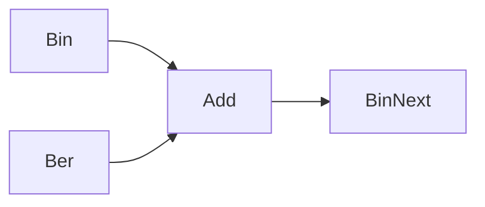

# Lecture Block 8-9 Exercises

This page collects the exercise patterns from [[stochastics]] pages labelled Exercise 8 and Exercise 9.

## Exercise 8: binomial plus Bernoulli

For $X\sim\mathrm{Bin}(n,p)$ and independent $Y\sim\mathrm{Ber}(p)$, only $Y=0$ and $Y=1$ contribute:
$$
\mathbb{P}(X+Y=m)=\mathbb{P}(X=m)\mathbb{P}(Y=0)+\mathbb{P}(X=m-1)\mathbb{P}(Y=1).
$$
The source simplifies this with Pascal's identity to
$$
\mathbb{P}(X+Y=m)=\binom{n+1}{m}p^m(1-p)^{n+1-m},
$$
so $X+Y\sim\mathrm{Bin}(n+1,p)$.

MGF method:
$$
M_X(t)=(pe^t+1-p)^n,\qquad M_Y(t)=pe^t+1-p,
$$
so $M_{X+Y}(t)=(pe^t+1-p)^{n+1}$.



## Exercise 8: exponential moments

For $X\sim\mathrm{Exp}(\lambda)$, the source uses
$$
M_X(t)=\frac{\lambda}{\lambda-t},\qquad t<\lambda,
$$
and moment recovery to compute
$$
\mathbb{E}[X^\ell]=\frac{\ell!}{\lambda^\ell},
\qquad
\mathrm{Var}(X)=\frac1{\lambda^2}.
$$

## Exercise 8: two dice under conditioning

A fair ordinary die and a fair six-sided die labelled by ones and twos are rolled. Event $A$ says the labelled die shows $1$. Let $B_i$ be the event that the sum equals $i$. Conditional on $A$, the sum is uniformly distributed on $\{2,\ldots,7\}$, so the source concludes
$$
\mathbb{E}[X+Y\mid A]=4.5.
$$

## Exercise 8: sum of two uniform variables

For independent $X,Y\sim U(0,1)$,
$$
f_{X+Y}(t)=\begin{cases}
t,&t\in[0,1],\\
2-t,&t\in(1,2],\\
0,&\text{otherwise}.
\end{cases}
$$
The source also computes
$$
M_X(t)=\frac{e^t-1}{t}\quad(t\ne0),\qquad M_X(0)=1,
$$
and $M_{X+Y}(t)=M_X(t)^2$.

## Exercise 9: grid uniforms converge to continuous uniform

Let $X_n$ be uniformly distributed on $\{1/n,2/n,\ldots,n/n\}$ and let $X\sim U(0,1)$. The CDF is
$$
F_n(t)=\begin{cases}
0,&t\le0,\\
\lfloor nt\rfloor/n,&t\in(0,1),\\
1,&t\ge1.
\end{cases}
$$
Since $\lfloor nt\rfloor/n\to t$ for $t\in(0,1)$, $X_n\xrightarrow{d}X$.

## Exercise 9: Erlang sums

The source defines $\mathrm{Erl}(\lambda,n)$ and proves by induction that the sum of $n$ independent $\mathrm{Exp}(\lambda)$ variables is $\mathrm{Erl}(\lambda,n)$. It then applies the [[central-limit-theorem]]:
$$
\frac{\sum_{k=1}^{n}X_k-n/\lambda}{\sqrt n/\lambda}\xrightarrow{d}\mathcal{N}(0,1).
$$

## Exercise 9: 900 dice and bounding methods

If $X$ counts how often a six appears in 900 fair die rolls, then $X\sim\mathrm{Bin}(900,1/6)$,
$$
\mathbb{E}[X]=150,\qquad \mathrm{Var}(X)=125.
$$

| Method | Source result |
|---|---|
| [[markov-inequality]] | $\mathbb{P}(X\ge200)\le150/200$ and $\mathbb{P}(X\ge160)\le150/160$ |
| [[chebyshev-inequality]] | $\mathbb{P}(X\ge200)\le125/50^2=0.05$ |
| [[normal-approximation]] | $\mathbb{P}(X\ge200)\approx6\cdot10^{-6}$, $\mathbb{P}(X\ge160)\approx0.212$ |

## Exercise 9: convergence in probability examples

- If $X_n\sim\mathrm{Exp}(n)$, then $X_n\xrightarrow{P}0$ because $e^{-n\varepsilon}\to0$.
- If $X_n=\prod_{i=1}^nY_i$ for i.i.d. $Y_i\sim\mathrm{Ber}(p)$ with $0<p<1$, then $X_n\xrightarrow{P}0$ because $p^n\to0$.

## Generalizable takeaway

```text
1. For a sum, first check independence.
2. If exact laws are wanted, try convolution or MGFs.
3. If only tail control is needed, use Markov or Chebyshev with the available moments.
4. If n is large and a standardized sum appears, use CLT or De Moivre-Laplace.
5. If convergence is requested, choose probability convergence for deviations and distribution convergence for CDF limits.
```

## See also

[[conditional-expectation]], [[moment-generating-function]], [[convolution-of-distributions]], [[convergence-of-random-variables]], [[erlang-distribution]], [[stochastics]]

