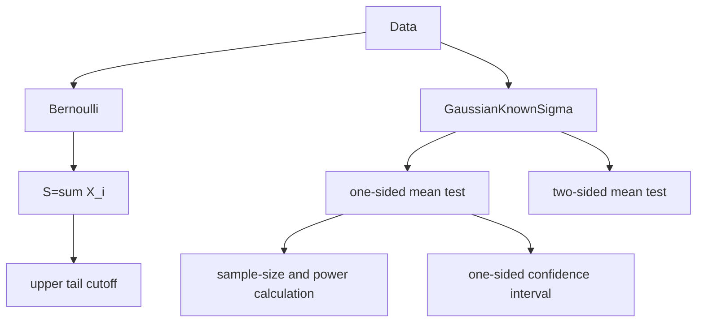

# Statistical Inference Exercises

This page records worked exercise patterns from the second half of [[stochastics-1]]. The main block is statistical inference, with some review exercises on distributions, sums, [[markov-chain|Markov chains]], the [[poisson-process]], the [[weak-law-large-numbers]], and the [[central-limit-theorem]].

## Page-to-topic map

| Pages | Exercise pattern |
|---|---|
| p.26 | Complete the [[maximum-likelihood-estimation]] derivation for the geometric model. |
| p.27 | Fish mark-recapture model and an unbiased estimator for $1/N$. |
| p.28-p.29 | Definition of [[confidence-intervals]] and Gaussian mean interval with known standard deviation. |
| p.30-p.34 | [[hypothesis-testing]] definitions, type I/type II errors, binomial test, one-sided and two-sided Gaussian tests. |
| p.35-p.36 | [[exponential-distribution]] quantiles and half-life calculation. |
| p.37-p.39 | One-sided Gaussian confidence interval, test inversion, and sample-size formula for power. |
| p.40 | One-sided binomial test application with $n=457$, observed count $35$, and benchmark $p_0=0.11$. |
| p.41 | Review exercise on permutations, independence, and conditional probability. |
| p.42-p.44 | Density $f(x)=2-2x$ on $[0,1]$, CDF, mean, variance, and median. |
| p.45 | Convolution of a geometric variable and an independent Bernoulli variable. |
| p.46 | Weak law statement and CLT proof of $e^{-n}\sum_{k=0}^n n^k/k!\to1/2$. |
| p.47 | Two-state Markov-chain transition matrix and state probabilities. |
| p.48 | Poisson-process independent-increment calculation. |
| p.49 | One-sided Gaussian test with $n=25$, $\sigma_0=0.25$, $\bar{x}=5.1$. |
| p.50 | [[pareto-distribution]] estimator $1/X$ is unbiased for $\alpha/(\alpha+1)$. |

> WARNING: Unreadable in source: stochastics-1.pdf p.40 has partially unclear handwriting in the application story; the statistical values $n=457$, observed count $35$, $p_0=0.11$, and error level $0.05$ are readable.

## Worked patterns

### Geometric maximum likelihood

The continuation on p.26 writes the log likelihood in the convention
$$
L_x(p)=\prod_{i=1}^n p^{x_i}(1-p)
$$
so that
$$
\log L_x(p)=n\bar{X}_n\log p+n\log(1-p).
$$
Solving
$$
\frac{d}{dp}\log L_x(p)=\frac{n\bar{X}_n}{p}-\frac{n}{1-p}=0
$$
gives
$$
\hat p=\frac{\bar{X}_n}{1+\bar{X}_n}.
$$
This uses the resolved primary convention on [[geometric-distribution]]: $p$ is the continuation probability and the success probability is $1-p$.

### Mark-recapture

If $N$ is the unknown fish population size, $M$ fish are marked, and a later catch of size $n$ contains $X$ marked fish, then
$$
\mathbb{P}_N(X=k)=\frac{{M\choose k}{N-M\choose n-k}}{{N\choose n}}.
$$
The notes show
$$
\mathbb{E}_N\left[\frac{X}{Mn}\right]=\frac1N,
$$
so $X/(Mn)$ is an unbiased estimator for $1/N$. See [[mark-recapture-estimation]].

### Binomial and Gaussian testing recipes

```text
1. For Bernoulli data, use the count S = sum_i X_i.
2. For H0: p <= p0 against H1: p > p0, reject only for a sufficiently large S.
3. Choose the cutoff m0 so that the upper binomial tail at p0 is at most alpha.
4. For normal data with known sigma0, use the sample mean.
5. For H0: mu <= mu0 against H1: mu > mu0, reject if Xbar_n >= mu0 + z_(1-alpha) sigma0/sqrt(n).
6. For H0: mu = mu0 against H1: mu != mu0, reject outside the symmetric z_(1-alpha/2) band.
```



For the source's measurement exercise, $n=25$, $\sigma_0=0.25$, $\alpha=0.05$, $\mu_0=5$, and $\bar{x}=5.1$. The critical value is approximately $5.0822$, so $H_0$ is rejected.

### Distribution-review exercises

For the density $f(x)=2-2x$ on $[0,1]$:
$$
F_X(y)=
\begin{cases}
0,&y<0,\\
2y-y^2,&0\le y\le1,\\
1,&y>1,
\end{cases}
$$
$$
\mathbb{E}[X]=\frac13,
\quad
\mathbb{E}[X^2]=\frac16,
\quad
\mathrm{Var}(X)=\frac1{18},
\quad
m=1-\frac1{\sqrt2}
$$
where $m$ is a median.

For independent $Y$ and $Z$ with $\mathbb{P}(Y=k)=2^{-(k+1)}$ for $k\in\mathbb{N}_0$ and $Z\sim\mathrm{Ber}(1/2)$,
$$
\mathbb{P}(Y+Z=0)=\frac14,
\qquad
\mathbb{P}(Y+Z=\ell)=\frac{3}{2^{\ell+2}},\quad \ell>0.
$$

### Limit and process exercises

The CLT is used with $S_n\sim\mathrm{Poisson}(n)$ to show
$$
\lim_{n\to\infty}e^{-n}\sum_{k=0}^n\frac{n^k}{k!}
=\lim_{n\to\infty}\mathbb{P}(S_n\le n)=\Phi(0)=\frac12.
$$

For a Poisson process $(N_t)$ of intensity $1$,
$$
\mathbb{P}(N_2=4,N_{\log 16}=4)
=\mathbb{P}(N_2=4)\mathbb{P}(N_{\log16}-N_2=0)
=\frac1{24}.
$$

For the two-state Markov chain with transition matrix
$$
P=\begin{pmatrix}1/2&1/2\\1&0\end{pmatrix},
$$
the source computes from $p(1)=(1/2,1/2)$ that
$$
p(2)=p(1)P=(3/4,1/4).
$$

## Generalizable takeaway

The inference pages use the same repeated pattern: choose a statistic with a known distribution under the null, choose a cutoff from a [[quantile]] or an exact binomial tail, then translate the cutoff into a test, interval, or required sample size.

## See also

[[confidence-intervals]], [[hypothesis-testing]], [[mark-recapture-estimation]], [[maximum-likelihood-estimation]], [[quantile]], [[normal-distribution]], [[binomial-distribution]], [[exponential-distribution]], [[pareto-distribution]]

