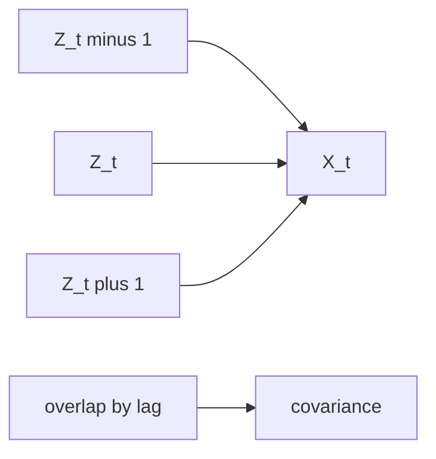

# Stochastic Processes and Statistics Exercises

This page collects worked patterns from the first half of [[stochastics-1]], especially [[markov-chain]], [[brownian-motion]], [[poisson-process]], and [[point-estimation]].

## Markov chain: machine operability

With state order `(operable, inoperable)`,
$$
P=\begin{pmatrix}9/10&1/10\\1/2&1/2\end{pmatrix},
\qquad p(0)=(1,0),
$$
and $p(t)=p(0)P^t$.

## Chebyshev standard-deviation bounds

Given $\mu=\mathbb{E}[X]$ and $\sigma=\sqrt{\mathrm{Var}(X)}$, [[chebyshev-inequality]] gives $\mathbb{P}(|X-\mu|\ge t\sigma)\le1/t^2$. Thus the p.6 exercise lists bounds $1$, $1/2$, $1/4$, and $1/25$ for $t=1,\sqrt2,2,5$. To guarantee at least $0.96$ probability inside an interval around $\mu$, take $c=5\sigma$.

## Moving-average covariance

Let $(Z_t)_{t\in\mathbb{Z}}$ be i.i.d. with $\mathbb{E}[Z_1]=\mu$ and $\mathrm{Var}(Z_1)=\sigma^2$, and define $X_t=(Z_{t-1}+Z_t+Z_{t+1})/3$. Then $\mathbb{E}[X_t]=\mu$ and
$$
\mathrm{cov}(X_s,X_t)=
\begin{cases}
\frac13\sigma^2,& s=t,\\
\frac29\sigma^2,& s\in\{t-1,t+1\},\\
\frac19\sigma^2,& s\in\{t-2,t+2\},\\
0,&\text{otherwise.}
\end{cases}
$$



## Brownian scaling and Poisson splitting

For $c>0$, $\tilde B_t=B_{ct}/\sqrt{c}$ is again [[brownian-motion]]. For a [[poisson-process]],
$$
\mathbb{P}(N_s=k\mid N_t=n)=\binom{n}{k}\left(\frac{s}{t}\right)^k\left(1-\frac{s}{t}\right)^{n-k}.
$$

## Consecutive heads Markov chain

For $X_t\in\{0,1,2\}$ counting successive heads until two successive heads have appeared,
$$
P=\begin{pmatrix}1/2&1/2&0\\1/2&0&1/2\\0&0&1\end{pmatrix},
$$
state $2$ is absorbing, and $p(t)\to(0,0,1)$.

## Uniform endpoint estimation

For i.i.d. $U_i\sim U([0,a])$, $2\bar U$ is unbiased. The maximum $U_{(n)}$ has CDF $(t/a)^n$ on $0<t<a$, density $n t^{n-1}/a^n$, mean $an/(n+1)$, and bias $-a/(n+1)$. Hence $(n+1)U_{(n)}/n$ is unbiased.

## Generalizable takeaway

```text
1. For stochastic-process exercises, identify states or increments first.
2. If a transition matrix is present, fix the state order before multiplying.
3. For covariance functions, count which underlying independent variables overlap.
4. For estimator exercises, compute expectation to test bias.
5. For consistency, use convergence in probability, often via the weak law of large numbers.
6. For maximum likelihood, fix the observed sample before maximizing over the parameter.
```

## See also

[[stochastic-process]], [[markov-chain]], [[poisson-process]], [[brownian-motion]], [[point-estimation]], [[maximum-likelihood-estimation]]

