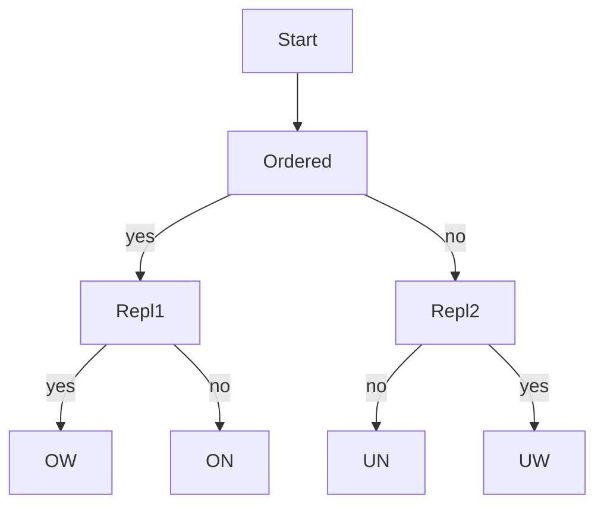

# Combinatorial Counting

## Goal / when to use

Use counting when a [[laplace-probability-space]] reduces a probability to
$$\mathbb{P}(A)=\frac{|A|}{|\Omega|}.
$$
The notes organize counting by an urn model with $M$ balls and $n$ draws.

## Assumptions

- Decide whether samples are ordered or unordered.
- Decide whether drawing is with replacement or without replacement.
- For balls into bins, decide whether balls are distinguishable and whether bins can receive multiple balls.

## Procedure

```text
1. Define the sample space Omega precisely.
2. Decide whether elementary outcomes are equally likely.
3. If equally likely, classify the counting model:
   a. ordered with replacement,
   b. ordered without replacement,
   c. unordered without replacement,
   d. unordered with replacement.
4. Count |Omega| using the matching formula.
5. Translate the event A into the same representation.
6. Count |A|.
7. Return \mathbb{P}(A) = |A| / |Omega|.
```

## Decision diagram



## Counting formulas from the notes

| Model | Count |
|---|---:|
| Ordered samples with replacement | $M^n$ |
| Ordered samples without replacement | $M!/(M-n)!$ for $n\le M$ |
| Unordered samples without replacement | $\binom{M}{n}=M!/((M-n)!n!)$ |
| Unordered samples with replacement | $\binom{M+n-1}{n}$ |

The source also states Pascal's identity
$$
\binom{m}{k}=\binom{m-1}{k-1}+\binom{m-1}{k}
$$
and the binomial theorem
$$
(a+b)^m=\sum_{i=0}^{m}\binom{m}{i}a^i b^{m-i}.
$$

## Worked example

For a six-sided die thrown twice, use ordered samples with replacement:
$$
\Omega=\{1,\ldots,6\}^2,
\qquad |\Omega|=36.
$$
The event "the number 3 occurs exactly once" has $10$ ordered outcomes, so its probability is $10/36$.

## Common mistakes

- Counting unordered outcomes when the experiment records an ordered sequence.
- Forgetting that "with replacement" allows repeated values.
- Mixing event counts from one model with a denominator from another model.

## See also

[[inclusion-exclusion-principle]], [[binomial-distribution]], [[lecture-block-1-2-exercises]]

