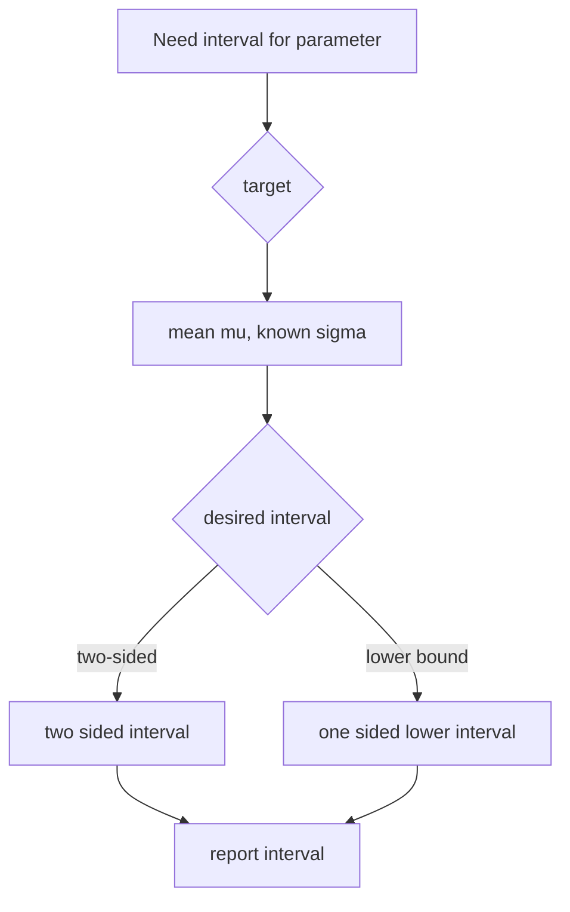

# Confidence Intervals

## Goal / when to use

Use a confidence interval when a statistical model contains an unknown parameter $\theta\in\Theta$ and the task is to report a data-dependent interval that contains a real target $\tau(\theta)$ with confidence level at least $1-\alpha$.

## Assumptions

- A statistical model $(X,\mathcal{F}_X,(\mathbb{P}_\theta)_{\theta\in\Theta})$ is specified.
- The target is a function $\tau:\Theta\to\mathbb{R}$.
- The interval-valued statistic $C:X\to I$ maps each sample to an interval in a chosen set $I$ of real intervals.
- The desired error level is $\alpha\in(0,1)$.

## Procedure

```text
1. Identify the target tau(theta) and the sampling distribution of a statistic such as the sample mean.
2. Choose a probability statement whose probability is at least 1 - alpha for every theta.
3. Algebraically solve that statement for tau(theta) being inside an interval C(X).
4. Report C(x) after substituting the observed sample x.
5. State the confidence level 1 - alpha and the assumptions, especially known variance when used.
```

## Definition from the notes

A confidence interval for $\tau(\theta)$ with error level $\alpha$ satisfies
$$
\mathbb{P}_\theta\bigl(\{x\in X:\tau(\theta)\in C(x)\}\bigr)\ge1-\alpha
\quad\text{for all }\theta\in\Theta.
$$

## Decision diagram



## Worked examples

### Two-sided Gaussian mean interval, known standard deviation

Let $X_1,\ldots,X_n$ be independent $\mathcal{N}(\mu,\sigma_0^2)$ variables with known $\sigma_0>0$. Since
$$
\bar{X}_n\sim\mathcal{N}\left(\mu,\frac{\sigma_0^2}{n}\right),
$$
choose $z_{1-\alpha/2}$ with $\Phi(z_{1-\alpha/2})=1-\alpha/2$. Then
$$
C(X)=\left(\bar{X}_n-z_{1-\alpha/2}\frac{\sigma_0}{\sqrt n},
\bar{X}_n+z_{1-\alpha/2}\frac{\sigma_0}{\sqrt n}\right)
$$
is a confidence interval for $\mu$ with error level $\alpha$.

### One-sided Gaussian mean interval from test inversion

For the same model, the smallest constant $c$ making
$$
C(X)=(\bar{X}_n-c,\infty)
$$
a level-$1-\alpha$ confidence interval is
$$
c=z_{1-\alpha}\frac{\sigma_0}{\sqrt n}.
$$
Thus
$$
C(X)=\left(\bar{X}_n-z_{1-\alpha}\frac{\sigma_0}{\sqrt n},\infty\right).
$$
Page 38 links this interval to the one-sided Gaussian [[hypothesis-testing|test]]: $H_0:\mu\le\mu_0$ is not rejected exactly when $\mu_0$ lies in the one-sided interval.

## Common mistakes

- A confidence interval is random before observing data; the parameter is fixed.
- The Gaussian formulas above use a known standard deviation $\sigma_0$.
- Use $z_{1-\alpha/2}$ for two-sided intervals and $z_{1-\alpha}$ for one-sided intervals.

## See also

[[quantile]], [[normal-distribution]], [[hypothesis-testing]], [[point-estimation]], [[stochastics-1]]

