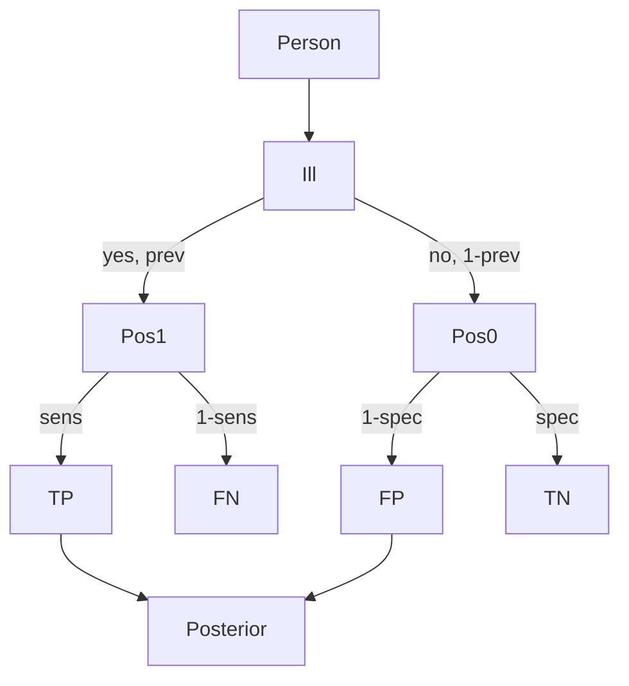

# Diagnostic Testing with Bayes

## Goal / when to use

Use this method when a test result is observed and the desired probability is the posterior probability of the true condition. The source phrases this using prevalence, sensitivity, and specificity.

## Assumptions

- $A=\{\text{ill}\}$ and $B=\{\text{tested positive}\}$.
- Prevalence $\mathrm{prev}=\mathbb{P}(A)$.
- Sensitivity $\mathrm{sens}=\mathbb{P}(B\mid A)$.
- Specificity $\mathrm{spec}=\mathbb{P}(B^c\mid A^c)$.
- The positive-test probability is nonzero.

## Procedure

```text
1. Define A as the condition of interest and B as the positive test.
2. Write prev = \mathbb{P}(A), sens = \mathbb{P}(B | A), and spec = \mathbb{P}(B^c | A^c).
3. Convert specificity into the false-positive rate: \mathbb{P}(B | A^c) = 1 - spec.
4. Compute \mathbb{P}(B) = prev * sens + (1 - prev) * (1 - spec).
5. Compute \mathbb{P}(A | B) = prev * sens / \mathbb{P}(B).
6. Interpret the result as the posterior probability of being ill after a positive test.
```

## Decision diagram



## Formula

By [[bayes-formula]],
$$
\mathbb{P}(A\mid B)=
\frac{\mathrm{prev}\cdot\mathrm{sens}}
{\mathrm{prev}\cdot\mathrm{sens}+(1-\mathrm{prev})(1-\mathrm{spec})}.
$$

## Worked example

The source states that if $\mathrm{sens}=1$ and $\mathrm{spec}=0$, then every test is positive. If $\mathrm{sens}=0$ and $\mathrm{spec}=1$, then every test is negative. These are sanity checks for the definitions.

For the communication-channel exercise, the same [[law-of-total-probability]] plus [[bayes-formula]] pattern is used: split by the transmitted symbol and condition on the received symbol.

## Common mistakes

- Confusing $\mathbb{P}(A\mid B)$ with $\mathbb{P}(B\mid A)$.
- Treating specificity as $\mathbb{P}(B\mid A^c)$ instead of $\mathbb{P}(B^c\mid A^c)$.
- Ignoring prevalence; rare conditions can have low posterior probability even when sensitivity is high.

## See also

[[conditional-probability]], [[bayes-formula]], [[lecture-block-4-5-exercises]], [[stochastics-4-5]]

