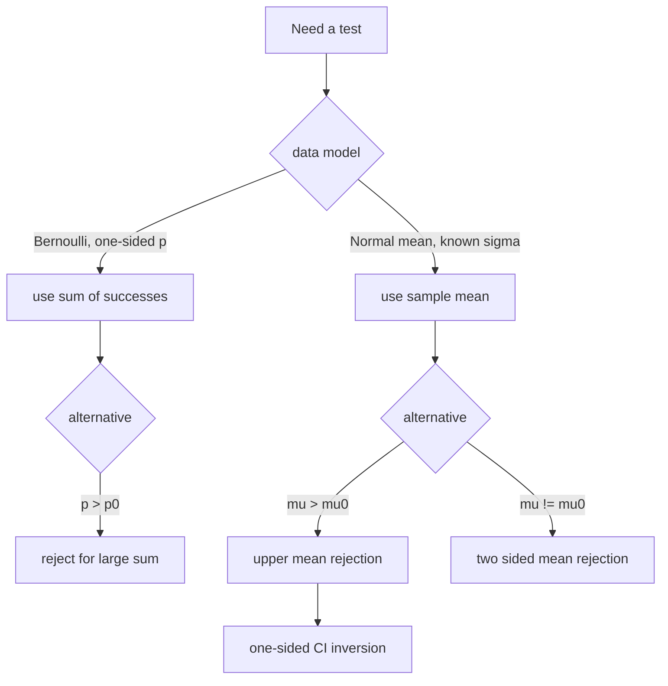

# Hypothesis Testing

## Goal / when to use

Use a statistical test to decide, from observed data, whether to reject a null hypothesis $H_0$ in favor of an alternative $H_1$ while controlling the probability of a type I error.

## Assumptions

- A statistical model $(X,\mathcal{F}_X,(\mathbb{P}_\theta)_{\theta\in\Theta})$ is specified.
- The parameter space is split into disjoint hypotheses $\Theta_0$ and $\Theta_1$ with $\Theta_0\cup\Theta_1=\Theta$.
- $H_0:\theta\in\Theta_0$ is the null hypothesis; $H_1:\theta\in\Theta_1$ is the alternative.
- The test is a measurable map $\varphi:X\to\{0,1\}$, where $\varphi(x)=1$ means reject $H_0$.

## Procedure

```text
1. Specify the statistical model and parameter theta.
2. State H0 as theta in Theta0 and H1 as theta in Theta1.
3. Choose a test statistic S(X) whose values become more extreme under H1.
4. Choose a rejection region K so that P_theta(S(X) in K) <= alpha for all theta in Theta0.
5. Define phi(x) = 1 if S(x) is in K and phi(x) = 0 otherwise.
6. For observed x, compute S(x) and decide reject H0 if phi(x) = 1.
7. If requested, compute the power P_theta(phi(X)=1) for theta in Theta1 or the type II probability P_theta(phi(X)=0).
```

## Error types, level, and power

A test has significance level $\alpha$ if
$$
\mathbb{P}_\theta(\varphi(X)=1)\le\alpha
\quad\text{for all }\theta\in\Theta_0.
$$
For $\theta\in\Theta_1$, the power is
$$
\mathbb{P}_\theta(\varphi(X)=1).
$$
The source's error table is:

| Decision | Truth $\theta\in\Theta_0$ | Truth $\theta\in\Theta_1$ |
|---|---|---|
| $\varphi(X)=0$ | correct | type II error |
| $\varphi(X)=1$ | type I error | correct |

## Decision diagram




## Formula-summary cross-check

`stochastics_formulas.pdf` p.2 corroborates the general test notation $H_0:	heta\in\Theta_0$, $H_1:	heta\in\Theta_1$, the decision rule $\varphi:X\to\{0,1\}$, the level condition $\mathbb{P}_\theta(\varphi(X)=1)\le\alpha$ for $\theta\in\Theta_0$, and the power $\mathbb{P}_\theta(\varphi(X)=1)$. It also repeats the one-sided Gaussian and one-sided binomial patterns below; the lower-right binomial rejection-rule handwriting is partly obscured by a punched hole, so the wiki keeps the cleaner version from `stochastics-1.pdf` p.30-34.

## Tests from the source

### One-sided binomial test

For independent $X_i\sim\mathrm{Ber}(p)$, test
$$
H_0:p\le p_0
\quad\text{against}\quad
H_1:p>p_0.
$$
Let $m_0$ be the smallest integer such that
$$
\sum_{k=m_0+1}^n {n\choose k}p_0^k(1-p_0)^{n-k}\le\alpha.
$$
Define
$$
\varphi(x)=
\begin{cases}
0,&\sum_{i=1}^n x_i\le m_0,\\
1,&\sum_{i=1}^n x_i>m_0.
\end{cases}
$$
The source uses monotonicity of the binomial upper tail to conclude this is a level-$\alpha$ test.

### One-sided Gaussian mean test, known standard deviation

For independent $X_i\sim\mathcal{N}(\mu,\sigma_0^2)$, test
$$
H_0:\mu\le\mu_0
\quad\text{against}\quad
H_1:\mu>\mu_0.
$$
Reject when
$$
\bar{X}_n\ge\mu_0+z_{1-\alpha}\frac{\sigma_0}{\sqrt n}.
$$

### Two-sided Gaussian mean test, known standard deviation

For the same Gaussian model, test
$$
H_0:\mu=\mu_0
\quad\text{against}\quad
H_1:\mu\ne\mu_0.
$$
Do not reject if
$$
\bar{X}_n\in\left(\mu_0-z_{1-\alpha/2}\frac{\sigma_0}{\sqrt n},
\mu_0+z_{1-\alpha/2}\frac{\sigma_0}{\sqrt n}\right),
$$
and reject otherwise. The rejection probability under $\mu=\mu_0$ is $\alpha$.

### Sample size for desired type II bound

For the one-sided Gaussian test, suppose the true mean is $\mu_1>\mu_0$ and the desired upper bound for the type II probability is $\beta$. The source derives the sufficient and necessary bound
$$
n\ge
\frac{(z_{1-\alpha}+z_{1-\beta})^2\sigma_0^2}{(\mu_1-\mu_0)^2}.
$$

## Worked source application

In the measurement exercise with $n=25$, known standard deviation $\sigma_0=0.25$, $\alpha=0.05$, and hypotheses $H_0:\mu\le5$ against $H_1:\mu>5$, the critical value is
$$
5+z_{0.95}\frac{0.25}{\sqrt{25}}\approx5.0822.
$$
Since the observed sample mean is $5.1$, the source rejects $H_0$.

## Common mistakes

- $\varphi(X)=0$ means only "cannot reject $H_0$", not that $H_0$ has been proven true.
- Type I error is rejecting a true null; type II error is not rejecting a false null.
- Match the rejection direction to the alternative hypothesis.

## See also

[[confidence-intervals]], [[quantile]], [[binomial-distribution]], [[normal-distribution]], [[statistical-inference-exercises]], [[stochastics-1]]

