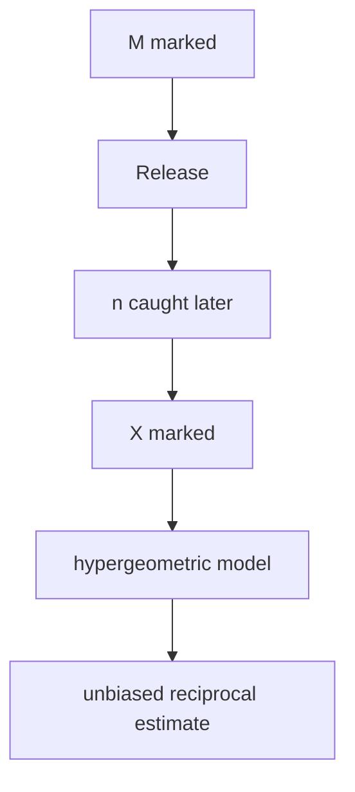

# Mark-Recapture Estimation

## Goal / when to use

Use mark-recapture estimation when a population has unknown size $N$, a known number $M$ of individuals are marked and released, and a later sample of size $n$ is inspected for marked individuals.

## Assumptions

- The population has $N$ individuals, of which $M$ are marked and $N-M$ are unmarked.
- A second catch of size $n$ is taken without replacement.
- $X$ is the number of marked individuals in the second catch.
- The source models $X$ by a [[hypergeometric-distribution|hypergeometric]] law.

## Procedure

```text
1. Mark M individuals in a population and release them.
2. Later catch n individuals from the mixed population.
3. Count X, the number of marked individuals in the second catch.
4. Use the hypergeometric model P_N(X = k) = C(M,k) C(N-M,n-k) / C(N,n).
5. For estimating 1/N, report X / (M n), which is unbiased in the source.
6. If estimating N itself, do not invert blindly without analyzing bias; the source proves unbiasedness only for 1/N.
```

## Model from the source

For $k$ in the feasible range,
$$
\mathbb{P}_N(X=k)=\frac{{M\choose k}{N-M\choose n-k}}{{N\choose n}}.
$$
Since $\mathbb{E}_N[X]=nM/N$ for the hypergeometric model,
$$
\mathbb{E}_N\left[\frac{X}{Mn}\right]=\frac1N.
$$
Thus $X/(Mn)$ is unbiased for $1/N$.

## Decision diagram



## Worked example

The notes formulate the fish-pond problem: catch and mark $M$ fish, release them, later catch $n$ fish, and use the count $X$ of marked fish to estimate population size information.

## Common mistakes

- The source's unbiased estimator is for $1/N$, not directly for $N$.
- The second catch is without replacement, so the hypergeometric model is used rather than the binomial model.

## See also

[[point-estimation]], [[hypergeometric-distribution]], [[stochastics-1]], [[statistical-inference-exercises]]

