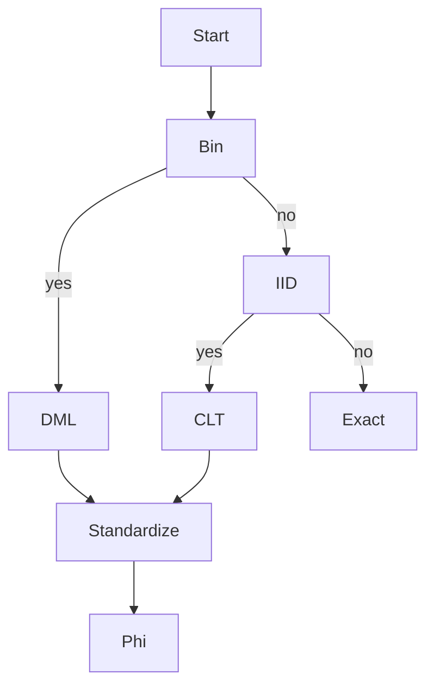

# Normal Approximation

## Goal / when to use

Use normal approximation when a probability for a large [[binomial-distribution]] or large i.i.d. sum is inconvenient to compute exactly and a [[central-limit-theorem]] or [[de-moivre-laplace-theorem]] approximation is allowed by the source.

## Assumptions

- For the binomial form: $Y_n\sim\mathrm{Bin}(n,p)$ with $p\in(0,1)$.
- $n$ is large enough that the approximation is meaningful.
- Standard normal values $\Phi(t)$ are available.

## Procedure

```text
1. Identify the count or sum and its mean m.
2. Identify its variance v and standard deviation sqrt(v).
3. Rewrite the target event in standardized form (X - m) / sqrt(v).
4. Replace the standardized CDF by the standard normal CDF Phi.
5. Convert upper tails with 1 - Phi(t).
6. Report that the result is an approximation, not an exact equality.
```

## Decision diagram



## Worked example

For 900 fair die rolls, $X$ counts sixes. Then $X\sim\mathrm{Bin}(900,1/6)$,
$$
\mathbb{E}[X]=150,\qquad \mathrm{Var}(X)=125.
$$
The source approximates
$$
\mathbb{P}(X\ge200)\approx 1-\Phi\left(\frac{199-150}{\sqrt{125}}\right)
=1-\Phi(4.38)\approx 6\cdot10^{-6},
$$
and
$$
\mathbb{P}(X\ge160)\approx1-\Phi(0.80)\approx0.212.
$$

## Common mistakes

- Do not confuse this approximation with exact [[markov-inequality]] or [[chebyshev-inequality]] bounds.
- Use the variance of the whole count, not the variance of one Bernoulli trial.

## See also

[[de-moivre-laplace-theorem]], [[central-limit-theorem]], [[normal-distribution]], [[lecture-block-8-9-exercises]]

