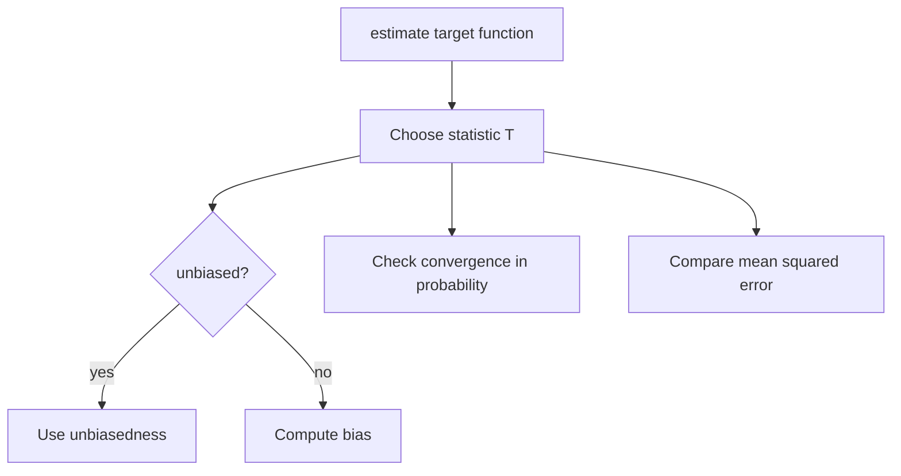

# Point Estimation

## Goal / when to use

Use point estimation when a statistical model contains an unknown parameter $\theta\in\Theta$ and the task is to estimate a real quantity $\gamma(\theta)$ from an observed sample.

## Statistical model

The notes define a statistical model as a triple $(X,\mathcal{F}_X,(\mathbb{P}_\theta)_{\theta\in\Theta})$, where $X$ is the sample space, $\mathcal{F}_X$ is a $\sigma$-algebra, and $(\mathbb{P}_\theta)_{\theta\in\Theta}$ is a family of probability measures. For each $\theta$, $(X,\mathcal{F}_X,\mathbb{P}_\theta)$ is a [[probability-space]].

## Assumptions

- A statistical model is specified.
- A sample $x=(x_1,\ldots,x_n)$ or observations $X_1,\ldots,X_n$ are available.
- The target quantity is a real-valued function $\gamma:\Theta\to\mathbb{R}$.

## Procedure

```text
1. Identify the model and the unknown parameter theta.
2. Identify the target quantity gamma(theta).
3. Choose a measurable statistic T from the sample space to R.
4. Compute E_theta[T], if bias is requested.
5. Declare T unbiased when E_theta[T] = gamma(theta) for all theta.
6. Otherwise compute the bias B_T(theta) = E_theta[T] - gamma(theta).
7. For a sequence T_n, test consistency by checking convergence in probability to gamma(theta).
8. Compare precision by mean squared error when second moments exist.
```

## Core definitions

A measurable map $T:X\to\mathbb{R}$ is called a point estimator for $\gamma(\theta)$. If $\mathbb{E}_\theta[|T|]<\infty$ for all $\theta$, then $T$ is unbiased for $\gamma(\theta)$ if
$$
\mathbb{E}_\theta[T]=\gamma(\theta)
\quad\text{for all }\theta\in\Theta.
$$
Otherwise, the bias is $B_T(\theta)=\mathbb{E}_\theta[T]-\gamma(\theta)$.

If $\mathbb{E}_\theta[T^2]<\infty$, the source records
$$
\mathbb{E}_\theta[(T-\gamma(\theta))^2]
=\mathrm{Var}_\theta(T)+B_T(\theta)^2.
$$

A sequence $(T_n)$ is consistent for $\gamma(\theta)$ if for all $\theta\in\Theta$ and $\varepsilon>0$,
$$
\lim_{n\to\infty}\mathbb{P}_\theta(|T_n-\gamma(\theta)|\ge\varepsilon)=0.
$$

## Worked examples from the source

For a sample $x=(x_1,\ldots,x_n)$,
$$
\bar{x}=\frac1n\sum_{i=1}^n x_i,
\qquad
s_x^2=\frac1{n-1}\sum_{i=1}^n(x_i-\bar{x})^2.
$$

The formula summary also records the sample median for sorted observations $x_{(1)}\le\cdots\le x_{(n)}$:
$$
m_x=
\begin{cases}
x_{((n+1)/2)},& n\text{ odd},\\
\dfrac{x_{(n/2)}+x_{(n/2+1)}}2,& n\text{ even}.
\end{cases}
$$

For i.i.d. observations with finite first moment, the sample mean is unbiased for $\mathbb{E}_\theta[X_1]$. With finite second moment and $n\ge2$, the sample variance is unbiased for $\mathrm{Var}_\theta(X_1)$.

If $\mathbb{E}_m[X_1]=m$ and $\hat m_n=(n-1)^{-1}\sum_{i=1}^nX_i$, then $B_{\hat m_n}(m)=m/(n-1)$, but the [[weak-law-large-numbers]] shows $\hat m_n\xrightarrow{P}m$.

For i.i.d. $U_i\sim U([0,a])$, $2\bar U$ is unbiased. The maximum $U_{(n)}$ has $\mathbb{E}_a[U_{(n)}]=an/(n+1)$, so $(n+1)U_{(n)}/n$ is unbiased.

## Additional estimators from p.26-50

- In the fish [[mark-recapture-estimation]] model, the hypergeometric count $X$ satisfies $\mathbb{E}_N[X]=nM/N$, so $X/(Mn)$ is unbiased for $1/N$.
- For $X\sim$ [[pareto-distribution|Pareto]]$(\alpha)$ with density $f(x)=\alpha x^{-\alpha-1}$ on $[1,\infty)$, the statistic $T(X)=1/X$ is unbiased for $\alpha/(\alpha+1)$ because
$$
\mathbb{E}_\alpha[T(X)]=\int_1^\infty \frac1x\alpha x^{-\alpha-1}\,dx=\frac{\alpha}{\alpha+1}.
$$

## Decision diagram



## Common mistakes

- An estimator is a function of the sample, not of the unknown parameter directly.
- Unbiasedness is not the same as consistency.
- A biased estimator can still be consistent.

## See also

[[maximum-likelihood-estimation]], [[mark-recapture-estimation]], [[confidence-intervals]], [[hypothesis-testing]], [[weak-law-large-numbers]], [[variance-covariance-correlation]], [[uniform-distribution]], [[stochastics-1]]

