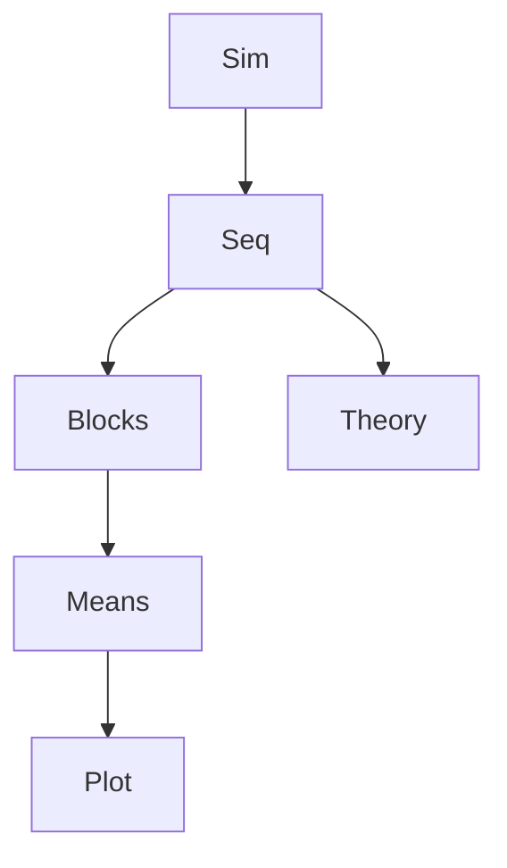

# Simulation by Random Sampling

## Goal / when to use

Use simulation to imitate repeated random experiments and inspect empirical frequencies. The source simulates $1{,}000{,}000$ fair coin tosses with values $0$ and $1$ sampled with equal probability.

## Assumptions

- The random generator samples $0$ and $1$ with the same probability.
- The simulated experiment corresponds to a [[product-probability-space]] on $\{0,1\}^{1{,}000{,}000}$.
- Counts over fixed-size blocks are compared to a [[binomial-distribution]].

## Procedure

```text
1. Choose the number of repetitions N.
2. Generate N independent outcomes from the target elementary distribution.
3. Split the output into equal-size blocks if block frequencies are desired.
4. For each block, compute the mean or count of successes.
5. Plot the empirical frequencies.
6. Compare the pattern with the theoretical distribution.
```

## Decision diagram



## Worked example

The source sketches R-style commands:

```text
1. Generate a vector `head` with 1,000,000 random 0/1 values.
2. For i = 100, 200, ..., 1,000,000:
   record the mean of the current block of 100 tosses.
3. Plot the sequence of block means.
```

The formula noted is
$$\mathbb{P}(A)=\sum_{k\in A}\binom{n}{k}0.5^k0.5^{n-k},
$$
which is the fair-coin [[binomial-distribution]].

## Common mistakes

- Confusing a simulated sequence with the theoretical probability model.
- Forgetting that block frequencies of length $100$ fluctuate around $0.5$.

## See also

[[probability-distribution]], [[product-probability-space]], [[lecture-block-1-2-exercises]]

