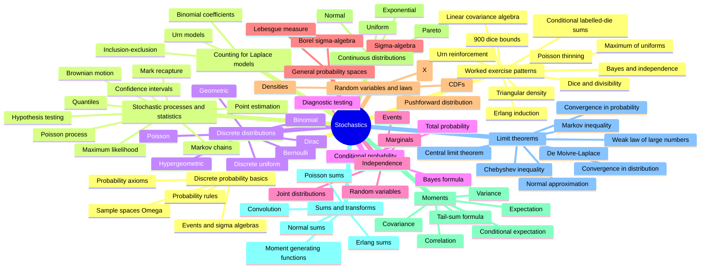

# Overview — Stochastics (TUHH)

Course map after ingesting [[stochastics-1-2]], [[stochastics-4-5]], [[stochastics-6-7]], [[stochastics]], all of [[stochastics-1]], and the final formula-summary source [[stochastics-formulas]]. The covered material now spans finite/countable probability models, counting, named discrete and continuous distributions, conditional probability, independence, measure-theoretic probability-space language, random variables, distribution functions, expectation, variance, covariance, correlation, conditional expectation, sums/convolutions, moment generating functions, probability inequalities, convergence, laws of large numbers, the central limit theorem, Erlang sums, normal approximation, [[stochastic-process|stochastic processes]], [[markov-chain|Markov chains]], [[poisson-process]], [[brownian-motion]], [[point-estimation]], [[maximum-likelihood-estimation]], [[confidence-intervals]], [[hypothesis-testing]], [[quantile|quantiles]], and [[mark-recapture-estimation]].

## Current path through the material

1. Start with [[discrete-probability-space]] to understand $\Omega$, events, and $\mathbb{P}$.
2. Use [[probability-rules]] and [[inclusion-exclusion-principle]] to manipulate events.
3. In finite equally likely settings, use [[laplace-probability-space]] plus [[combinatorial-counting]].
4. Move from event probabilities to laws in [[probability-distribution]] and [[random-variable]].
5. Build repeated experiments with [[product-probability-space]].
6. Recognize named discrete laws: [[dirac-distribution]], [[bernoulli-distribution]], [[geometric-distribution]], [[binomial-distribution]], [[poisson-distribution]], [[hypergeometric-distribution]], and [[discrete-uniform-distribution]].
7. Add information with [[conditional-probability]], [[law-of-total-probability]], and [[bayes-formula]].
8. Check event and random-variable [[independence]], including [[joint-and-marginal-distributions|joint/marginal criteria]].
9. Generalize the model with [[sigma-algebra]] and [[probability-space]].
10. Use [[cumulative-distribution-function]] and [[probability-density]] for real-valued distributions.
11. Recognize continuous laws: [[uniform-distribution]], [[exponential-distribution]], [[normal-distribution]], and [[pareto-distribution]].
12. Compute [[expectation]], then [[variance-covariance-correlation]].
13. Extend expectation with [[conditional-expectation]] and [[wald-identity]].
14. For sums of independent variables, use [[convolution-of-distributions]] or [[moment-generating-function]]; recognize [[erlang-distribution]] as a sum of exponentials.
15. Bound tails with [[markov-inequality]] and [[chebyshev-inequality]].
16. Study limits through [[convergence-of-random-variables]], [[weak-law-large-numbers]], [[central-limit-theorem]], [[de-moivre-laplace-theorem]], and [[normal-approximation]].
17. Use [[stochastic-process]], [[markov-chain]], [[poisson-process]], and [[brownian-motion]] for the stochastic-process material.
18. Use [[point-estimation]], [[maximum-likelihood-estimation]], [[mark-recapture-estimation]], [[quantile]], [[confidence-intervals]], and [[hypothesis-testing]] for the statistics block.
19. Practice through [[lecture-block-1-2-exercises]], [[lecture-block-4-5-exercises]], [[lecture-block-6-7-exercises]], [[lecture-block-8-9-exercises]], [[stochastic-processes-and-statistics-exercises]], [[statistical-inference-exercises]], [[simulation-by-random-sampling]], and [[diagnostic-testing-bayes]].

## Status

- Sources ingested: 6 of 6 raw PDFs. Ingested: `Stochastics_1_2.pdf`, `stochastics_4_5.pdf`, `stochastics_6_7.pdf`, `stochastics.pdf`, `stochastics-1.pdf` p.1-50, and `stochastics_formulas.pdf` p.1-2.
- Covered: Stochastics lecture blocks 1-2, pages 1-22; lecture blocks 4-5, pages 1-20; lecture blocks 6-7, pages 1-34; `stochastics.pdf` pages 1-28, later KVB notes and exercises 8-9; `stochastics-1.pdf` pages 1-50, including stochastic processes, estimation, confidence intervals, hypothesis testing, and inference exercises; `stochastics_formulas.pdf` pages 1-2, formula-summary verification and cheatsheet consolidation.
- See [[index]] for the page catalog and [[log]] for history.
- Remaining gaps from previous lint passes, source ambiguities, and formula-sheet corrections are tracked in [[open-questions]]. The collection still has no scan for lecture block 3; this is a source-collection gap, not an un-ingested PDF.

