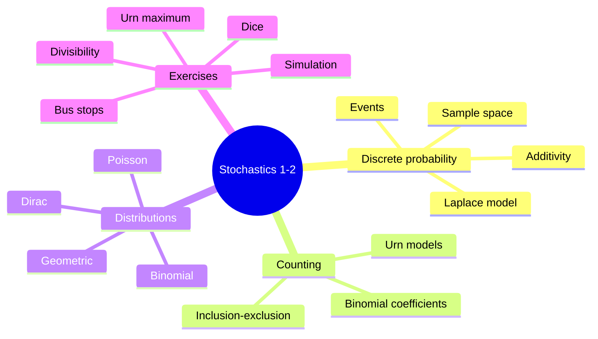

# Stochastics_1_2.pdf — lecture blocks 1-2

This source introduces [[discrete-probability-space|discrete probability spaces]], elementary set rules for probability, [[combinatorial-counting|counting methods]], and first [[probability-distribution|discrete probability distributions]]. It also contains exercise work on dice, divisibility, bus stops, urn maxima, shifted geometric laws, and simulation.

## Page coverage

| Pages | Content |
|---|---|
| p.1-3 | Random experiments, sample spaces, events, power sets, discrete probability spaces, basic probability rules, [[inclusion-exclusion-principle]]. |
| p.4-9 | [[combinatorial-counting|Urn models and counting]]: ordered/unordered, replacement/no replacement, binomial coefficients, Pascal identity, binomial theorem, increasing sequences. |
| p.10-12 | Worked exercise applications: divisibility by $2$, $3$, or $19$; five-digit counting patterns. |
| p.11-16 | [[probability-distribution|Discrete probability distributions]], [[laplace-probability-space|Laplace]], [[dirac-distribution|Dirac]], [[product-probability-space]], [[geometric-distribution]], [[binomial-distribution]], [[poisson-distribution]]. |
| p.17-21 | Exercise identities, bus-stop occupancy, maximum in repeated urn draws, shifted geometric distribution. |
| p.22 | [[simulation-by-random-sampling|Simulation]] of $1{,}000{,}000$ fair coin tosses and block frequencies. |

## Key takeaways

- A discrete probability space is a countable sample space with a probability function on events satisfying normalization and additivity.
- For finite equally likely outcomes, [[laplace-probability-space|Laplace probabilities]] reduce probability questions to counting: $\mathbb{P}(A)=|A|/|\Omega|$.
- Many exercises are solved by decomposing events into disjoint parts, complements, or by using [[inclusion-exclusion-principle]].
- Urn-model counting has four main cases depending on order and replacement.
- A nonnegative point-mass function $(p_\omega)_{\omega\in\Omega}$ summing to $1$ defines a [[probability-distribution|discrete distribution]].
- Product probability spaces model repeated independent experiments such as dice throws and coin tossing.
- The notes introduce [[dirac-distribution]], [[geometric-distribution]], [[binomial-distribution]], and [[poisson-distribution]].

## Pages created from this source

- [[discrete-probability-space]]
- [[laplace-probability-space]]
- [[probability-distribution]]
- [[product-probability-space]]
- [[probability-rules]]
- [[inclusion-exclusion-principle]]
- [[combinatorial-counting]]
- [[simulation-by-random-sampling]]
- [[dirac-distribution]]
- [[geometric-distribution]]
- [[binomial-distribution]]
- [[poisson-distribution]]
- [[lecture-block-1-2-exercises]]

