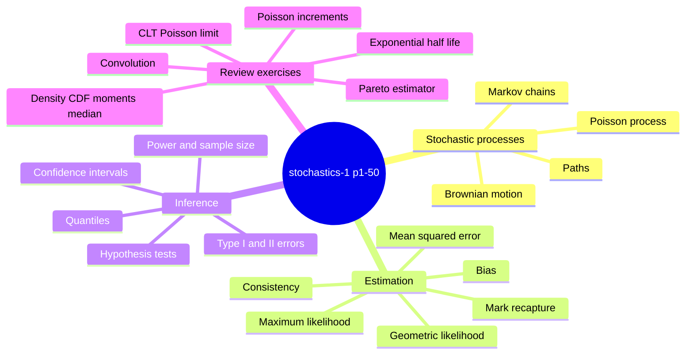

# stochastics-1.pdf - KVB notes

`stochastics-1.pdf` is a later KVB notes block, not the missing introductory lecture block 3. Across 50 pages it bridges stochastic processes into mathematical statistics and then closes with mixed review exercises. It extends the course map from [[stochastic-process|stochastic processes]] through [[markov-chain|Markov chains]], the [[poisson-process]], [[brownian-motion]], [[point-estimation]], [[maximum-likelihood-estimation]], [[confidence-intervals]], [[quantile|quantiles]], [[hypothesis-testing]], and [[mark-recapture-estimation]].

## Page-range topic map

| Pages | Main content |
|---|---|
| p.1 | Definition of a [[stochastic-process]] $(X_t)_{t\in T}$, paths $t\mapsto X_t(\omega)$, random walks from partial sums, and independent increments. |
| p.2-p.5 | Discrete-time [[markov-chain|Markov chains]], transition probabilities $p_{ij}$, matrix update $p(t+1)=p(t)P$, a simple random walk, and a two-state machine example. |
| p.3, p.10 | [[poisson-process]] from exponential waiting times and counting process $N_t$; independent increments and the conditional binomial law $\mathbb{P}(N_s=k\mid N_t=n)=\binom{n}{k}(s/t)^k(1-s/t)^{n-k}$. |
| p.4, p.8-p.9 | Mean and covariance functions of processes; moving-average example $X_t=(Z_{t-1}+Z_t+Z_{t+1})/3$. |
| p.4, p.11-p.13 | [[brownian-motion]] definition and exercises: start at $0$, continuous paths, independent Gaussian increments, and scaling $(B_{ct}/\sqrt{c})_{t\ge0}$. |
| p.6-p.7 | [[chebyshev-inequality]] bounds at $1$, $\sqrt2$, $2$, and $5$ standard deviations; comparison with the normal three-sigma probability. |
| p.14-p.18 | Statistical models, samples, statistics, sample mean, sample variance, sample median, estimators, unbiasedness, bias, consistency, and MSE decomposition. |
| p.19-p.20 | [[maximum-likelihood-estimation]] definition; uniform-on-prefix MLE; Markov-chain exercise for consecutive heads. |
| p.21-p.24 | Estimator bias/consistency and uniform $[0,a]$ estimation using $2\bar{X}_n$, the sample maximum, and a bias-corrected maximum estimator. |
| p.25-p.26 | Geometric likelihood in the primary TUHH convention $\mathbb{P}_p(X=x)=p^x(1-p)$; MLE $\hat p=\bar{X}_n/(1+\bar{X}_n)$. |
| p.27 | Fish [[mark-recapture-estimation]] model with hypergeometric count $X$ and unbiased estimator $X/(Mn)$ for $1/N$. |
| p.28-p.29 | [[confidence-intervals]], Gaussian mean interval for known $\sigma_0$, and [[quantile]] definition. |
| p.30-p.34 | [[hypothesis-testing]] setup, type I/type II errors, significance level, power, exact binomial upper-tail tests, and Gaussian mean tests. |
| p.35-p.39 | [[exponential-distribution]] quantiles, one-sided Gaussian confidence interval, test inversion, and Gaussian sample-size/power formula. |
| p.40 | One-sided binomial test application with readable values $n=457$, observed count $35$, $p_0=0.11$, and level $0.05$; story text is partly unclear. |
| p.41-p.45 | Review exercises on permutations, independence, conditional probability, a triangular density, CDF/moments/median, and convolution of a geometric variable with an independent Bernoulli variable. |
| p.46-p.50 | [[weak-law-large-numbers]], [[central-limit-theorem]] proof of the Poisson limit $e^{-n}\sum_{k=0}^n n^k/k!\to1/2$, a two-state Markov chain, Poisson-process increments, Gaussian testing, and a [[pareto-distribution]] estimator. |

## Key takeaways

- Stochastic processes are presented through paths, independent increments, Markov chains, Poisson processes, and Brownian motion.
- The statistics block moves in the order estimators $\to$ maximum likelihood $\to$ confidence intervals $\to$ hypothesis tests.
- Exact binomial tests use binomial tails; Gaussian tests and intervals use [[quantile|normal quantiles]].
- Test inversion connects one-sided Gaussian tests to one-sided Gaussian confidence intervals.
- The geometric-distribution convention is now resolved: the wiki uses the TUHH primary convention $\mathbb{P}(X=k)=p^k(1-p)$ on $\mathbb{N}_0$; the success-probability convention $q(1-q)^k$ is documented only as an alternative on [[geometric-distribution]].
- The final pages reuse earlier material on densities, convolutions, limit theorems, Markov chains, Poisson processes, and Pareto moments.

## Pages created or substantially introduced from this source

- [[stochastics-1]]
- [[stochastic-process]]
- [[markov-chain]]
- [[poisson-process]]
- [[brownian-motion]]
- [[point-estimation]]
- [[maximum-likelihood-estimation]]
- [[confidence-intervals]]
- [[hypothesis-testing]]
- [[mark-recapture-estimation]]
- [[quantile]]
- [[stochastic-processes-and-statistics-exercises]]
- [[statistical-inference-exercises]]

## Existing pages updated from this source

- [[chebyshev-inequality]]
- [[weak-law-large-numbers]]
- [[central-limit-theorem]]
- [[convergence-of-random-variables]]
- [[probability-space]]
- [[variance-covariance-correlation]]
- [[normal-distribution]]
- [[uniform-distribution]]
- [[geometric-distribution]]
- [[binomial-distribution]]
- [[exponential-distribution]]
- [[pareto-distribution]]
- [[overview]]
- [[index]]
- [[cheatsheet]]
- [[open-questions]]
- [[log]]

