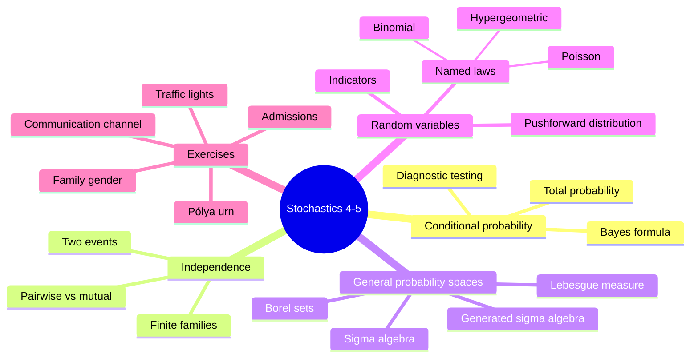

# stochastics_4_5.pdf — lecture blocks 4-5

This source extends the earlier [[discrete-probability-space]] material to [[conditional-probability]], [[law-of-total-probability]], [[bayes-formula]], [[independence]], general [[sigma-algebra|sigma-algebras]], [[probability-space|probability spaces]], [[random-variable|random variables]], and named distributions. It also contains exercise work on admissions, family gender conditioning, diagnostic testing, sigma-algebras, urn reinforcement, communication errors, and traffic lights.

## Page coverage

| Pages | Content |
|---|---|
| p.1 | [[law-of-total-probability]] with a machine-defect example: two machines, output shares $0.6,0.4$, defect rates $0.05,0.1$, total defect probability $0.07$. |
| p.2 | [[bayes-formula]] for a countable partition and a fire-detector posterior example. |
| p.3 | Definition of [[conditional-probability]], die example, and theorem that conditioning on $B$ defines a probability distribution on $\Omega$. |
| p.4 | [[independence]] for two and finitely many events; die example showing pairwise independence need not imply mutual independence. |
| p.5 | Admissions exercise using total probability across faculties; overall admission rates $0.625$ for women and $0.66$ for men. |
| p.6 | Family-gender exercise: conditioning on "at least one girl" gives probability $1/3$; conditioning on "the older child is a girl" gives $1/2$. |
| p.7-p.8 | Sensitivity, specificity, prevalence, and the posterior probability of illness after a positive diagnostic test. |
| p.9 | Exercise with $\Omega=\{a,b,c,d,e\}$: events $A,B,C$ are pairwise independent but not mutually independent. |
| p.10-p.12 | [[sigma-algebra]] and [[probability-space]] definitions, generated sigma-algebra, [[borel-sigma-algebra|Borel sigma-algebra]], and [[lebesgue-measure|Lebesgue measure]] examples. |
| p.13 | [[random-variable]] definition and distribution (pushforward law) of a random variable; two-child example. |
| p.14 | Indicator random variables, [[binomial-distribution]], [[poisson-distribution]], and [[hypergeometric-distribution]]. |
| p.15 | Exercise 4: Pólya-type urn with replacement plus an added same-color ball; induction shows the red probability remains $r/(r+b)$ each step. |
| p.16-p.17 | Communication-error exercise solved with [[bayes-formula]]; source arithmetic has a flagged inconsistency. |
| p.18 | Exercise 4, problem 3: construct the smallest [[sigma-algebra]] on $\{1,2,3,4\}$ containing $\{2,3\}$ and $\{4\}$. |
| p.19 | Exercise 4, problem 5: traffic lights; distribution of the number of lights passed before the first stop. |
| p.20 | Discrete distribution table; probabilities of $X>0$, $|X-1|\le 1$, and the distribution of $Y=X^2$. |

## Key takeaways

- Conditioning replaces the base space by information already known: $\mathbb{P}(A\mid B)=\mathbb{P}(A\cap B)/\mathbb{P}(B)$ for $\mathbb{P}(B)>0$.
- The [[law-of-total-probability]] computes an unconditional probability by summing over a countable disjoint partition.
- [[bayes-formula]] reverses conditioning by weighting likelihoods with prior probabilities.
- Pairwise [[independence]] is weaker than mutual independence for three or more events.
- A general [[probability-space]] uses a [[sigma-algebra]] of measurable events; the notes introduce [[borel-sigma-algebra|Borel sets]] and [[lebesgue-measure|Lebesgue measure]] as the continuous-model example.
- A [[random-variable]] maps outcomes to real numbers and induces a distribution on its image.
- The source adds [[hypergeometric-distribution]] and reinforces [[binomial-distribution]] and [[poisson-distribution]].

## Pages created from this source

- [[conditional-probability]]
- [[independence]]
- [[sigma-algebra]]
- [[probability-space]]
- [[random-variable]]
- [[law-of-total-probability]]
- [[bayes-formula]]
- [[diagnostic-testing-bayes]]
- [[hypergeometric-distribution]]
- [[lecture-block-4-5-exercises]]

## Pages updated from this source

- [[probability-distribution]]
- [[product-probability-space]]
- [[binomial-distribution]]
- [[poisson-distribution]]
- [[index]]
- [[overview]]
- [[open-questions]]
- [[log]]

