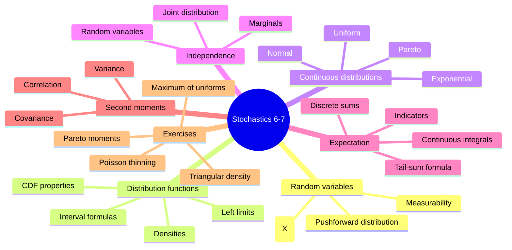

# stochastics_6_7.pdf — lecture blocks 6-7

This source extends [[random-variable|random variables]] from discrete examples to measurable real-valued maps, [[cumulative-distribution-function|distribution functions]], [[probability-density|densities]], named continuous distributions, [[expectation]], [[variance-covariance-correlation|variance, covariance, and correlation]], and worked exercise patterns.

## Page coverage

| Pages | Content |
|---|---|
| p.1 | General measurable [[random-variable]] definition, pushforward law $\mathbb{P}_X$, [[cumulative-distribution-function]], and [[bernoulli-distribution]] CDF. |
| p.2-p.3 | Existence theorem for distribution functions, [[probability-density]] definition, CDF from density, [[uniform-distribution]], CDF properties, left limits, point masses, and interval formulas. |
| p.4-p.5 | [[pareto-distribution]], [[exponential-distribution]], standard [[normal-distribution]], and affine normal $X=\mu+\sigma U$. |
| p.6-p.7 | [[independence|Independence of random variables]], CDF/point-mass criteria, die-coordinate example, [[joint-and-marginal-distributions|joint distribution and marginal distributions]]. |
| p.8-p.12 | Exercises: Poisson thinning by a binomial conditional law, a dependent joint table, triangular density with CDF, uniform $[2,4]$ CDF, and density of $Y=2X$. |
| p.13-p.17 | [[expectation]] for discrete and continuous variables, integrability, indicators, Poisson/binomial/uniform/exponential/normal means, and expectation properties. |
| p.18-p.24 | Worked expectation exercises: direct binomial mean, triangular density mean, discrete uniform mean, rectangle/product expectation, tail-sum formula, geometric tail/mean, maximum of uniforms, Poisson factorial moment, uniform second moment, and die variance. |
| p.25-p.26 | Functions of random variables, expectation of $h(X)$, computational variance formula, Poisson and uniform variances, scaling, shifting, and standard deviation. |
| p.27-p.28 | [[variance-covariance-correlation|Covariance and correlation]], covariance identity, zero covariance under independence, bilinearity, variance of sums, and binomial variance. |
| p.29-p.34 | Exercise block 7: triangular variance, discrete-uniform variance derivation, Poisson transform $\mathbb{E}[\lambda^{-X}]$, covariance/variance of linear combinations, Pareto mean/variance, and a symmetric Pareto-type transform with mean $0$. |

## Key takeaways

- A real-valued random variable must be measurable: inverse images of [[borel-sigma-algebra|Borel sets]] are events.
- A [[cumulative-distribution-function]] is nondecreasing, right-continuous, has limits $0$ and $1$, and encodes point masses and interval probabilities through jumps and left limits.
- A [[probability-density]] integrates to $1$ and produces a CDF by integration.
- New named laws are [[bernoulli-distribution]], [[uniform-distribution]], [[discrete-uniform-distribution]], [[exponential-distribution]], [[normal-distribution]], and [[pareto-distribution]].
- [[expectation]] is a weighted sum or integral when the positive and negative contributions are controlled.
- [[variance-covariance-correlation]] measures spread and linear dependence; independence implies zero covariance, but the notes do not state the converse.

## Pages created from this source

- [[cumulative-distribution-function]]
- [[probability-density]]
- [[expectation]]
- [[variance-covariance-correlation]]
- [[tail-sum-formula]]
- [[bernoulli-distribution]]
- [[uniform-distribution]]
- [[discrete-uniform-distribution]]
- [[exponential-distribution]]
- [[normal-distribution]]
- [[pareto-distribution]]
- [[lecture-block-6-7-exercises]]

## Pages updated from this source

- [[random-variable]]
- [[probability-distribution]]
- [[independence]]
- [[geometric-distribution]]
- [[binomial-distribution]]
- [[poisson-distribution]]
- [[index]]
- [[overview]]
- [[open-questions]]
- [[log]]

