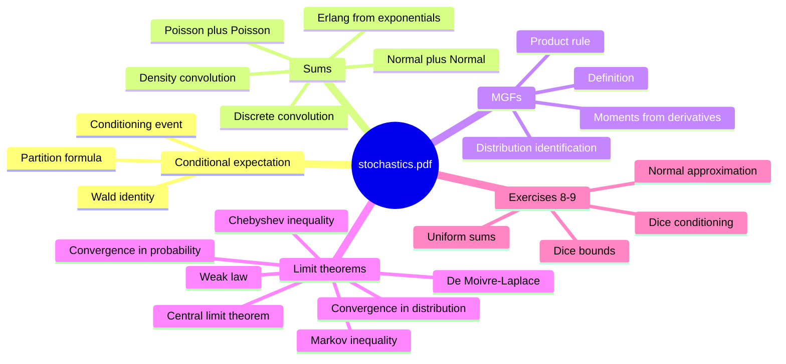

# stochastics.pdf — later KVB notes and exercises 8-9

This source is not an introductory duplicate. It is a later set of handwritten KVB notes plus exercise solutions, overlapping with [[expectation]], [[independence]], [[binomial-distribution]], [[poisson-distribution]], [[exponential-distribution]], [[normal-distribution]], and [[uniform-distribution]], but adding tools for sums and limits: [[conditional-expectation]], [[convolution-of-distributions]], [[moment-generating-function|moment generating functions]], [[wald-identity]], [[markov-inequality]], [[chebyshev-inequality]], [[weak-law-large-numbers]], [[convergence-of-random-variables]], [[central-limit-theorem]], [[de-moivre-laplace-theorem]], and the [[erlang-distribution]].

## Page coverage

| Pages | Content |
|---|---|
| p.1 | Conditional probability as a probability measure; [[conditional-expectation]]; die example; total expectation over a partition. |
| p.2-p.3 | [[convolution-of-distributions]] for independent integer-valued and density variables; sums of independent [[poisson-distribution|Poisson]] and [[normal-distribution|normal]] variables. |
| p.4-p.5 | [[moment-generating-function]] definition, Poisson MGF, uniqueness and moment recovery, and independent-sum product rule. |
| p.6-p.8 | Exercise 8: [[binomial-distribution]] plus [[bernoulli-distribution]] convolution and MGF proof; [[exponential-distribution]] MGF and moments. |
| p.9-p.10 | Exercise 8: two-die experiment with one ordinary die and one die labelled by ones/twos; conditional distribution of the sum given the labelled die shows $1$, and conditional expectation $4.5$. |
| p.11-p.12 | Sum of two independent $U(0,1)$ variables: triangular density and MGF. |
| p.13-p.14 | Random sum $Z=\sum_{k=1}^{N}X_k$ and [[wald-identity]]: $\mathbb{E}[Z]=\mathbb{E}[N]\mathbb{E}[X_1]$. |
| p.15-p.17 | [[markov-inequality]], [[chebyshev-inequality]], [[weak-law-large-numbers]], [[convergence-of-random-variables|convergence in probability and distribution]], and [[central-limit-theorem]]. |
| p.18 | [[de-moivre-laplace-theorem]] and normal approximation to binomial probabilities. |
| p.19-p.20 | Exercise 9: discrete uniform grid variables $X_n$ converge in distribution to $U(0,1)$; CDF sketch. |
| p.21-p.24 | [[erlang-distribution]] density and sums of independent exponentials via convolution; normal limit for Erlang sums. |
| p.25-p.27 | Exercise 9: 900 fair dice, [[markov-inequality]], [[chebyshev-inequality]], and [[normal-approximation]] estimates. |
| p.28 | Exercise 9: exponential variables converge in probability to $0$; product of Bernoulli variables converges in probability to $0$. |

## Key takeaways

- The document appears to cover material after lecture blocks 6-7, especially blocks/exercises 8-9.
- The main new theme is turning known distributions into sums and limits: convolution, MGFs, laws of large numbers, CLT, and normal approximation.
- Several old pages are enriched rather than duplicated: [[expectation]], [[variance-covariance-correlation]], [[exponential-distribution]], [[normal-distribution]], [[binomial-distribution]], [[poisson-distribution]], and [[uniform-distribution]].
- Exercise pages show how inequalities and limit theorems are used for concrete probability bounds.

## Pages created from this source

- [[conditional-expectation]]
- [[convolution-of-distributions]]
- [[moment-generating-function]]
- [[convergence-of-random-variables]]
- [[markov-inequality]]
- [[chebyshev-inequality]]
- [[weak-law-large-numbers]]
- [[central-limit-theorem]]
- [[de-moivre-laplace-theorem]]
- [[wald-identity]]
- [[erlang-distribution]]
- [[normal-approximation]]
- [[lecture-block-8-9-exercises]]

## Pages updated from this source

- [[expectation]]
- [[variance-covariance-correlation]]
- [[bernoulli-distribution]]
- [[binomial-distribution]]
- [[poisson-distribution]]
- [[exponential-distribution]]
- [[normal-distribution]]
- [[uniform-distribution]]
- [[index]]
- [[overview]]
- [[cheatsheet]]
- [[log]]

