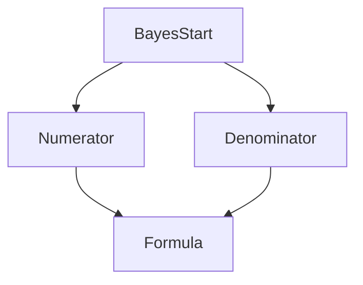

# Bayes Formula

## Statement

Let $(\Omega,\mathbb{P})$ be a [[discrete-probability-space]] and let $(B_i)_{i\in I}$ be an at most countable disjoint partition of $\Omega$ with $\mathbb{P}(B_i)>0$. For $A\subseteq\Omega$ with $\mathbb{P}(A)>0$,
$$
\mathbb{P}(B_i\mid A)=
\frac{\mathbb{P}(B_i)\mathbb{P}(A\mid B_i)}
{\sum_{j\in I}\mathbb{P}(B_j)\mathbb{P}(A\mid B_j)}.
$$

For two cases $B$ and $B^c$ this becomes
$$
\mathbb{P}(B\mid A)=
\frac{\mathbb{P}(B)\mathbb{P}(A\mid B)}
{\mathbb{P}(B)\mathbb{P}(A\mid B)+\mathbb{P}(B^c)\mathbb{P}(A\mid B^c)}.
$$

## Assumptions

- The $B_i$ form a partition.
- Each $\mathbb{P}(B_i)>0$.
- $\mathbb{P}(A)>0$, so conditioning on $A$ is defined.

## Proof sketch



## When to use it

Use Bayes formula to reverse a conditional probability: causes from observed effects, disease from a positive test, sent symbol from received symbol, or fire given alarm.

## Procedure

```text
1. Define the hidden cases B_i and the observed event A.
2. Write the prior probabilities \mathbb{P}(B_i).
3. Write the likelihoods \mathbb{P}(A | B_i).
4. Compute the denominator with the law of total probability.
5. Divide the matching numerator by the denominator.
```

## Worked examples

### Fire detector

With $B=\{\text{fire}\}$ and $A=\{\text{alarm}\}$, the source gives
$$
\mathbb{P}(B)=10^{-5},
\quad
\mathbb{P}(A\mid B)=0.99,
\quad
\mathbb{P}(A\mid B^c)=10^{-4}.
$$
Then
$$
\mathbb{P}(B\mid A)=
\frac{\mathbb{P}(B)\mathbb{P}(A\mid B)}
{\mathbb{P}(B)\mathbb{P}(A\mid B)+\mathbb{P}(B^c)\mathbb{P}(A\mid B^c)}
\approx 0.09.
$$

### Diagnostic testing

The diagnostic-test specialization is recorded in [[diagnostic-testing-bayes]].

## See also

[[conditional-probability]], [[law-of-total-probability]], [[diagnostic-testing-bayes]], [[lecture-block-4-5-exercises]]

